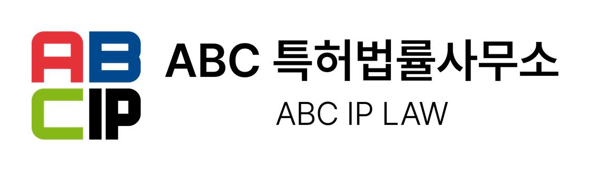

<p align="center">
  <a href="https://abcip.co.kr"></a>
</p>

# Startup IP Skills

**스타트업·중소기업 개발팀이 자기 프로젝트에서 직접 돌리는 지식재산 AI 에이전트 스킬**

ABC특허법률사무소(ABC IP LAW)가 공개합니다. 개발팀이 이미 AI 에이전트(Claude Code, Codex, Gemini CLI)와 일하고 있다면, 변리사가 특허를 찾고 거르는 방식도 그 에이전트에게 맡길 수 있습니다. [English](#english)

## 특허 포트폴리오 발굴

개발 중인 프로젝트에서 실행하면 에이전트가 코드·문서·수정 이력을 읽고 몇 가지를 여쭌 뒤

1. 사업과 고객에서 출발해 제품을 기술 요소로 나누고, 코드에서 **특허 후보**를 찾습니다.
2. 성립성·신규성 위험·진보성·권리 실효성·영업비밀 여부로 **특허성을 예비 판정**합니다(출원 권장 / 보강 후 검토 / 출원 비권장).
3. 원천·핵심 → 응용 → 신사업·해외로 이어지는 **포트폴리오를 설계**하고 빈 곳을 짚습니다.
4. 출원할 만한 발명마다 발명신고서를 대신할 **기술 설명서**를 씁니다.

Claude Code에서 아래 세 줄을 차례로 입력하세요.

```text
/plugin marketplace add abciplaw/startup-ip-skills
/plugin install abciplaw@startup-ip-skills
/abciplaw:patent-portfolio
```

Codex, Gemini CLI, 그 밖의 에이전트에서 쓰는 방법과 결과 파일 설명은 [abciplaw/README.md](abciplaw/README.md)에 있습니다. 가상의 프로젝트로 만든 결과 예시는 [examples/patent-portfolio/](examples/patent-portfolio/)에 있습니다.

## 꼭 알아 두실 것

- 결과는 프로젝트 안의 `patent-portfolio/` 폴더에만 저장되고 git에 올라가지 않도록 설정됩니다. 에이전트는 웹 검색·업로드를 하지 않으며, 사용자가 직접 보내기 전에는 어디로도 전달되지 않습니다.
- **결과물을 공개하지 마세요.** 공개 저장소, 이 저장소의 이슈, 블로그, AI 대화 공유 링크에 올리면 그 자체로 공개가 되어 특허를 받기 어려워질 수 있습니다.
- 판정과 제안은 선행기술 조사 없이 낸 **예비 의견**입니다. 출원 여부, 국가, 일정, 예산은 변리사와 상담해 정하세요.

## 검토 의뢰

결과 폴더를 압축해 보내 주시면 변리사가 검토해 출원 범위와 순서를 제안드립니다. '출원 비권장'으로 나온 항목도 함께 보내 주세요.

- 메일 abcip@abcip.co.kr
- 홈페이지 https://abcip.co.kr

## English

**Startup IP Skills** are open AI-agent skills that startup and SME development teams run on their own projects. They are published by ABC IP LAW, a Korean patent and trademark firm.

The first skill, **Patent Portfolio Discovery** (`/abciplaw:patent-portfolio`), finds patent candidates in your codebase and business context, screens them for patentability, plans a portfolio, and writes a disclosure for each invention worth filing. Output is in Korean by default. See [abciplaw/README.en.md](abciplaw/README.en.md).

```text
/plugin marketplace add abciplaw/startup-ip-skills
/plugin install abciplaw@startup-ip-skills
/abciplaw:patent-portfolio
```

## 라이선스 · License

[Apache License 2.0](LICENSE). 다시 배포할 때는 [LICENSE](LICENSE)와 [NOTICE](NOTICE)를 함께 실어야 합니다(제4조). 「ABC특허법률사무소」·「ABC IP LAW」·「abciplaw」 이름과 로고는 이 라이선스에 포함되지 않습니다(제6조). Redistributions must carry the NOTICE file (Section 4). The firm's names and logo are not licensed (Section 6).

<sub>이 저장소의 내용은 법률 자문이 아닙니다. Nothing in this repository is legal advice.</sub>
