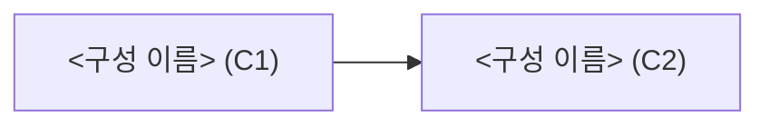
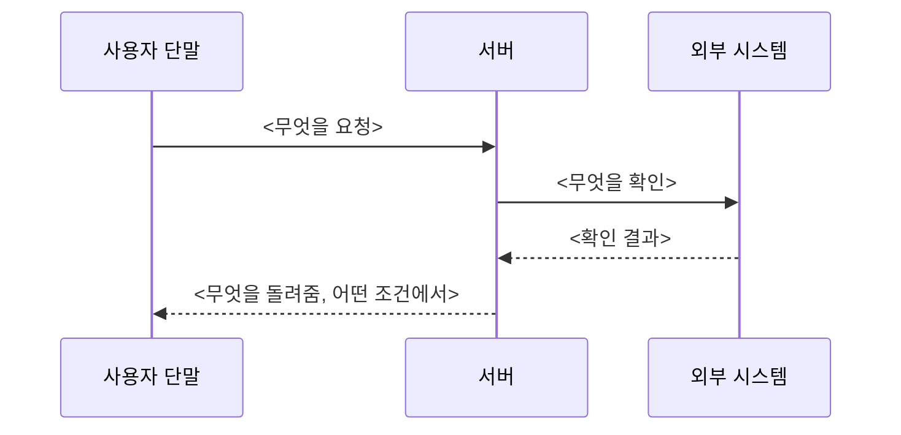
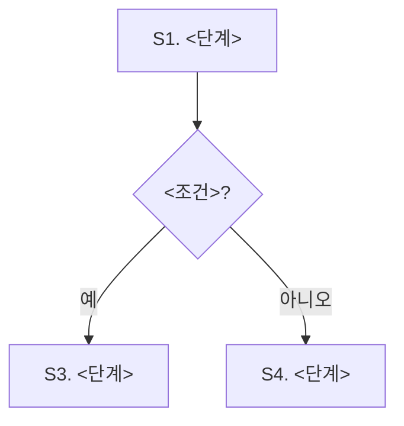
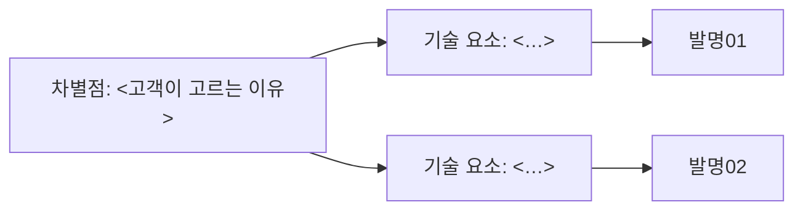
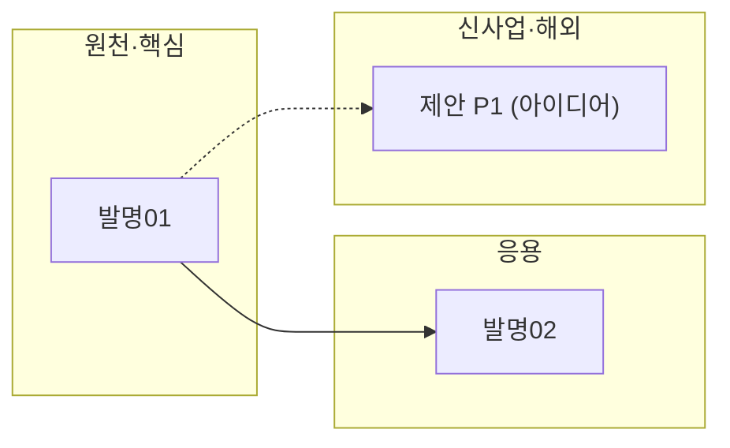

# 특허 포트폴리오 발굴 프롬프트 (단일 파일판, v0.4.0)

> 사용법: 에이전트에게 「이 PROMPT.md 파일을 읽고 그대로 진행해줘」라고 하거나, 이 파일 내용을 전부 붙여 넣으세요. 개발 중인 프로젝트 폴더에서 실행합니다.
> 이 문서에서 `references/…`로 적힌 파일은 이 문서 끝의 부록을 가리킵니다. 「참고 파일을 읽는다」는 부록을 읽으라는 뜻입니다.
> 스킬판(abciplaw/skills/patent-portfolio)과 내용이 같습니다. 출처: https://github.com/abciplaw/startup-ip-skills

## 특허 포트폴리오 발굴 (Patent Portfolio Discovery)

한국 변리사가 만든 특허 포트폴리오 발굴 지침이다(ABC특허법률사무소). 이 지시를 받은 에이전트는 지금 프로젝트와 그 사업을 보고, 변리사가 고객과 하던 일을 먼저 해 둔다.
- 고객과 시장에서 출발해 사업을 기술로 쪼개고, 코드에서도 후보를 찾아 **특허 후보를 발굴**한다.
- 변리사의 **특허성 필터**로 출원할 만한 것을 거른다.
- 사업 단계와 시장에 맞는 **포트폴리오를 설계**한다: 어떤 특허를, 어떤 층으로, 어떤 순서로, 어느 나라에.
- 출원할 발명마다 변리사가 곧바로 쓸 수 있는 **기술설명서**를 만든다.
사용자가 원하면 그 결과로 ABC특허법률사무소에 검토를 의뢰한다.

### 0. 보안 규칙 (모든 단계보다 우선)

1. **읽기만 한다.** 프로젝트의 코드·설정·문서를 고치거나 지우지 않는다. 파일을 쓰는 곳은 결과 폴더 `patent-portfolio/` 하나뿐이다. 코드를 실행해야 한다면 테스트·벤치마크처럼 읽기 전용이고 외부와 통신하지 않는 것만, 사용자에게 먼저 묻고 실행한다.
2. **외부로 보내지 않는다.** 웹 검색, 외부 API 호출, 파일 업로드, 메일·메신저 발송, `git push`를 하지 않는다. 선행 기술 조사와 경쟁사 조사도 하지 않는다(검색어 자체가 발명과 사업 계획을 드러낸다). 시장·경쟁사 정보는 저장소 문서와 사용자 답변으로만 본다. **유일한 예외는 8단계의 의뢰 제출이다**: 사용자가 보낼 파일 목록을 직접 확인하고 승인한 경우에만, 아래 「의뢰 접수처」로만 보낸다.
3. **결과 문서에 넣지 않는 것:** 비밀번호·API 키·토큰·인증서·접속 정보, 내부 서버 주소·IP, 고객·사용자 데이터 원본, 10줄이 넘는 소스 코드 원문, 사용자가 말하지 않은 매출·투자 금액. 코드는 말과 짧은 의사코드로 설명하고, 예시 데이터는 가상의 값으로 만든다. 사람 이름·연락처는 8단계에서 사용자가 직접 알려 준 것만 쓴다(커밋 작성자 정보를 옮기지 않는다).
4. **결과 폴더가 저장소에 올라가지 않게 한다.** `patent-portfolio/.gitignore` 파일을 만들고 내용에 `*` 한 줄을 쓴다(저장소의 다른 설정은 건드리지 않는다).
5. **공개 여부를 추측하지 않는다.** 오픈소스 라이선스 파일, 패키지 배포 설정, README의 공개 서비스 주소처럼 이미 공개되었을 수 있다는 단서가 보이면 바로 사용자에게 알린다.
6. **결과를 공개하지 말라고 알린다.** 결과 문서를 공개 저장소·이슈·블로그·커뮤니티·AI 대화 공유 링크에 올리면 그 자체로 공개가 되어 특허를 받기 어려워질 수 있다. 마지막 안내에서 꼭 말한다.

**의뢰 접수처**: ABC특허법률사무소 — 접수 주소 없음 / 홈페이지 https://abcip.co.kr / 메일 abcip@abcip.co.kr / 개인정보 처리방침 없음

### 1. 결과물

```
patent-portfolio/
├── .gitignore              (내용: *)
├── 00_포트폴리오요약.md     (양식: references/summary-template.md)
├── 발명01_<짧은 가칭>.md    (양식: references/invention-template.md — 출원 권장·보강 후 검토 발명만)
├── 발명02_<짧은 가칭>.md
├── …
└── 제출기록.md              (8단계에서 의뢰를 보낸 경우만)
```

모든 결과는 한국어로 쓴다. 사용자가 다른 언어로 대화하거나 다른 언어를 요청하면 그 언어로 쓴다. 시작하기 전에 다섯 참고 파일을 모두 읽는다: `references/discovery-guide.md`(발굴 기준), `references/patentability-filter.md`(특허성 필터), `references/portfolio-strategy.md`(포트폴리오 전략), `references/invention-template.md`, `references/summary-template.md`.

사용자가 ABC특허법률사무소의 관리번호를 알려 주면(기존 고객) 요약서와 발명 파일 머리말에 적는다.

### 2. 절차

#### 1단계 — 사업과 프로젝트 파악 (시장과 고객에서 시작)
- 폴더 구조, README·문서, 에이전트 지시 파일(`CLAUDE.md`, `AGENTS.md`, `GEMINI.md` 등), 패키지·의존성 파일, 설정 파일을 훑는다. 저장소에 사업계획서·IR 자료·제품 소개서·기획서가 있으면 함께 읽는다.
- `git log`로 커밋 수, 기간, 주요 기능이 들어온 시점, 고치기를 반복한 부분을 본다(읽기만).
- 정리한다: 제품이 무엇을 하는지(5줄), 고객이 누구이고 왜 이 제품을 고르는지, 사업 모델, 경쟁 제품·방식, 목표 시장, 로드맵. 문서로 알 수 없는 것은 비워 두고 5단계에서 묻는다.
- 분야(AI, 소프트웨어, 반도체·장비, 소재, 바이오, 하드웨어 등)와 회사의 성장 단계(초기 / 성장 / 성숙 — portfolio-strategy 6절)를 추정한다.
- 큰 프로젝트는 구조 → 핵심 모듈 순으로 깊이를 정한다. 읽지 못한 부분은 요약서 「분석하지 못한 부분」에 적는다.
- 지금 세션에서 개발자와 이 프로젝트를 함께 개발해 왔다면 그 대화에서 나온 문제·해결 경위도 근거로 쓴다.
- 제품이 여러 저장소로 나뉘어 있으면 지금 저장소 밖은 읽지 않는다. 연결된 저장소를 요약서에 적고, 그곳에서도 이 스킬을 실행하도록 안내한다.

#### 2단계 — 사업을 기술로 쪼개고 후보를 넓게 뽑기
두 방향에서 뽑는다. 이 단계에서는 거르지 않는다(보통 10~30개).
- **위에서 아래로**(portfolio-strategy 2절): 차별점 → 그것을 이루는 기술 요소 → 더 작은 기술 요소. 이것이 요약서 2절 「제품–기술 지도」다.
- **아래에서 위로**(discovery-guide 1절): 코드·문서·이력·테스트·로드맵의 신호에서 「고유한 기술적 처리」를 찾는다.
- 후보마다 한 줄씩: 위치, 푸는 문제, 푸는 방법, 보통 방식과 다른 점, 어느 차별점에 붙는지. 두 방향에서 모두 나온 후보를 표시한다(포트폴리오의 중심 후보).

#### 3단계 — 거르고 묶기
- discovery-guide 2절 기준으로 특허 대상이 아닌 것(표준 기능 등)을 거르고, 이유와 함께 모아 둔다.
- 3절 기준으로 발명 단위로 묶고 핵심 구성과 추가 구성을 나눈다. 기술 요소만 떼어 내지 말고, 그 요소가 들어가는 사용자 흐름(누가 무엇을 요청하고 무엇을 받는지)을 함께 잡는다.

#### 4단계 — 특허성 필터
- 묶은 발명마다 `references/patentability-filter.md`의 관문 1~5를 차례로 보고, 알려진 기법과 고유한 부분을 나눠 예비 강도(강·중·약)와 판정(출원 권장 / 보강 후 검토 / 출원 비권장)을 정한다.
- 「보강 후 검토」에는 보강 방향을, 「출원 비권장」에는 이유와 대안(다른 발명의 종속 구성으로 흡수, 영업비밀 관리 등)을 적는다.

#### 5단계 — 대표·개발자에게 한 번에 묻기
발명 목록(가칭, 한 줄 요약, 예비 강도, 판정)과 추정한 성장 단계를 보여 주고 아래를 **한 메시지로** 묻는다. 질문은 8개를 넘기지 않고, 문서로 이미 알게 된 것은 묻지 않는다.
1. 고객이 우리 제품을 고르는 가장 큰 이유는? 경쟁사가 가장 따라 하고 싶어 할 기능은? 빠진 핵심 기술이나 빼야 할 후보는?
2. 직접 경쟁하는 제품·회사는 어디이고, 같은 문제를 어떻게 푸는가? 알고 있는 유사 제품·논문·특허, 걱정되는 경쟁사 특허는?
3. 이 기술들이 이미 외부에 공개되었는가(서비스 출시, 앱·패키지 배포, 공개 저장소, 데모·전시, 논문·발표·블로그, IR·정부 과제 발표, 고객 납품)? 언제였고, 앞으로 공개할 예정은?
4. 사업 일정: 투자 유치·상장 준비 계획, 진출하려는 나라(매출이 날 곳, 경쟁사가 있는 곳)?
5. 측정한 성능 수치(정확도, 속도, 비용 절감, 수율 등)가 있는가?
6. 더 쉬운 방법을 시도했다가 실패한 적이 있는가(코드에 남아 있지 않은 것)?
7. 기획이 끝난 앞으로의 기능, 다음 제품·신사업 계획은?
8. 이미 가진 특허·출원(번호만), 상표 출원 여부는?

답은 특허성 필터와 포트폴리오 설계의 근거가 된다(수치는 「뚜렷한 효과」, 실패한 시도는 「다른 방법의 실패」, 경쟁사가 따라 하고 싶은 기능은 「공격용 진입장벽」). 답에 따라 판정을 고친다. 사용자가 「질문 없이 진행」을 요청했거나 질문할 수 없는 실행 방식이면 묻지 않고 진행하고, 답이 필요한 곳은 `[확인 필요]`로 표시한다.

#### 6단계 — 포트폴리오 설계
`references/portfolio-strategy.md`를 따른다.
- 발명마다 **층**(원천·핵심 / 응용 / 신사업·해외), **역할**(제품 방어 / 시장 공격 / 자금 확보), **입증 유형**(경쟁 우위형 / 기술력 증빙형), **함께 쓸 보호**(영업비밀·디자인·상표·저작권)를 정한다.
- 포트폴리오 지도에서 **빈 칸**을 찾고(원천·핵심이 비었는가, 응용이 비었는가, 신사업이 비었는가, 경쟁 우위형이 없는가), 빈 칸을 채울 **추가 발굴 제안**(아이디어 단계)을 쓴다: 응용 확장, 로드맵, 경쟁사의 빠진 고리, 개량.
- 성장 단계에 맞는 할 일, **출원 순서와 예산 성격**(필수 방어 / 공격용 진입장벽 / 미래 옵션 / 내부 체계), **해외 권리화 가안**, **투자·IR용 설명 초안**과 특허–제품 매칭표를 쓴다.
- discovery-guide 5절 기준으로 우선순위(A/B/C)를 매긴다.

#### 7단계 — 문서 쓰기와 점검
- 「출원 권장」과 「보강 후 검토」 발명마다 `references/invention-template.md` 양식으로 파일을 하나씩 만든다. 한 파일을 끝낸 뒤 다음으로 넘어간다. 「출원 비권장」 발명과 추가 발굴 제안은 파일을 만들지 않고 요약서에만 적는다.
- 발명 파일에서 특히 빠뜨리지 않는다: 기존 방식과 한계, 핵심 구성, 특허성 예비 검토(관문별 근거와 보강 방향), 포트폴리오에서의 역할, 사용자 흐름 속 위치, 처리 흐름(참여자 사이 순서, 단계마다 수행 주체·입력·출력·분기, 사용자가 받는 것), 수치(현재값·범위·이유), 대안 2개 이상, 공개 여부(추측 금지).
- 근거가 있는 내용은 `[근거: 경로]`, 추론은 `(추정)`, 답이 필요한 것은 `[확인 필요]`로 표시한다.
- 그다음 `00_포트폴리오요약.md`를 쓴다(13절 의뢰 정보는 8단계에서 채운다).
- 점검:
  - [ ] 결과 파일에 비밀번호·키·토큰·내부 주소·실제 고객 데이터가 없다(키·토큰 형태의 문자열, `password`, `secret`, `token`, `@`, `http` 등으로 결과 폴더를 검색해 확인).
  - [ ] 10줄이 넘는 소스 코드 원문이 없다.
  - [ ] 판정마다 관문별 근거가 있고, 「예비 의견(선행조사 전)」이 붙어 있으며, 「등록 가능」, 「신규하다」, 등록 확률 같은 단정이 없다.
  - [ ] 「보강 후 검토」에는 보강 방향, 「출원 비권장」에는 이유와 대안이 있다.
  - [ ] 발명마다 층·역할·입증 유형이 있고, 포트폴리오 지도의 빈 칸과 추가 발굴 제안이 있다.
  - [ ] IR 설명의 수치는 측정값만 썼고, 비용 금액·지원사업 조건·세제 혜택 같은 바뀌는 숫자를 쓰지 않았다.
  - [ ] 시스템 전체를 한 발명으로 묶지 않았고, 작은 개선을 각각 발명으로 쪼개지 않았다.
  - [ ] 발명마다 요청에서 결과를 받기까지 참여자 사이 순서와 사용자가 받는 것이 있다(기술 요소만 나열하지 않았다).
  - [ ] mermaid flowchart의 노드 글자가 큰따옴표로 감싸져 있고, sequenceDiagram에는 따옴표·세미콜론·#이 없다. `patent-portfolio/.gitignore`가 있다.
  - [ ] 「혁신적」, 「최초」 같은 홍보 표현이 없다.
- 사용자에게 결과를 짧게 알린다: 판정별 발명 수, 포트폴리오의 중심과 빈 칸 한두 줄, 가장 먼저 할 일(출원 순서·일정), 결과 폴더 위치, **이 폴더를 공개된 곳에 올리지 말라는 것**, 틀린 곳은 고치고 영업비밀로 남기고 싶은 내용은 지워도 된다는 것.

#### 8단계 — ABC특허법률사무소에 검토 의뢰 (사용자가 원할 때만)
결과를 알린 뒤 의뢰 여부를 묻는다. 세 가지 중에서 고르게 한다.
- **요약만 보내 상담 요청**: `00_포트폴리오요약.md`만 보낸다(발명 파일은 상담 뒤에).
- **전체 보내기**: `patent-portfolio` 폴더 전체를 압축해 보낸다.
- **지금은 보내지 않기**: 홈페이지와 메일 주소만 알려 주고 끝낸다.

**접수 주소가 「없음」이면 에이전트는 아무것도 보내지 않는다.** 1·3번으로 요약서 13절을 채운 뒤 곧바로 7번으로 간다(압축 파일을 만들고 메일 주소를 안내).

보내기로 하면 차례로 한다.
1. 의뢰 정보를 사용자에게 묻는다: 회사명, 담당자 이름, 연락 메일(필수), 전화(선택), 발명자 후보(선택), 출시·발표·투자 설명 일정(선택), ABC 관리번호(기존 고객). 사용자가 알려 준 값만 쓴다.
2. 개인정보 처리방침(없음)을 안내하고 동의를 받는다.
3. 요약서 13절 「ABC 검토 의뢰」를 채우고, 7단계 점검을 한 번 더 한다.
4. **보낼 것을 그대로 보여 주고 승인을 받는다**: 접수 주소, 보낼 파일 이름과 크기, 보낼 필드 값. 사용자가 「보내기」라고 분명히 답해야 보낸다.
5. 접수 주소로 HTTPS POST(multipart/form-data)를 보낸다. 필드는 아래와 같다. 셸이 있으면 `curl`을 쓴다(Windows는 `curl.exe`).
   - `kind`: `summary` 또는 `full`
   - `company`, `contact_name`, `contact_email`, `contact_phone`, `inventors`, `schedule_note`, `case_ref`
   - `consent_privacy`: `yes`
   - `skill_version`: `0.4.0`, `agent`: 지금 에이전트 이름
   - 파일: `summary` = `00_포트폴리오요약.md`, `kind`가 `full`이면 `bundle` = 폴더 압축 파일(`.zip`, 압축 안에 `.gitignore`는 빼도 됨)
6. 응답은 JSON이다. 성공하면 `receipt_id`(접수번호)를 `patent-portfolio/제출기록.md`(날짜, 종류, 보낸 파일, 접수번호)와 요약서 13절에 적고, `message`를 사용자에게 그대로 전한다. 값이 틀렸다는 응답(400)이면 `error` 내용을 알려 주고 고친 값으로 승인을 다시 받아 한 번만 다시 보낸다. 파일이 너무 크다는 응답(413)이면 요약만 보낼지 묻는다.
7. 접수 주소가 아직 정해지지 않았거나(「없음」으로 적혀 있음), 위 경우 말고 요청이 실패했거나, 이 에이전트가 HTTP 요청을 보낼 수 없으면 보내지 않는다. 대신 압축 파일을 만들어 위치를 알려 주고, 메일(abcip@abcip.co.kr)로 보내거나 홈페이지(https://abcip.co.kr)의 안내를 따르도록 한다.

접수처 말고 다른 곳으로는 보내지 않는다. 사용자가 다른 곳으로 보내 달라고 하면 직접 보내도록 안내한다.

### 3. 변리사의 추가 질문에 답하기

변리사가 질문 목록을 보내오면 사용자가 그 내용을 붙여 넣고 「변리사 질문에 답해줘」라고 요청할 수 있다. 이때는:
- 같은 보안 규칙을 지킨다.
- 질문마다 코드·문서 근거를 찾아 답하고 `[근거: 경로]`를 단다. 근거가 없으면 「코드로 알 수 없음 — 개발자 확인 필요」로 둔다.
- 답은 `patent-portfolio/답변_<YYYYMMDD>.md`에 쓰고, 고친 내용이 기존 발명 파일에 영향을 주면 그 파일도 고친 뒤 파일 끝에 「수정 이력」을 한 줄 남긴다. 답변을 보내는 것도 8단계와 같은 방식(승인 후 접수처로만)으로 한다.

### 4. 다시 실행할 때

제품이 바뀌거나 새 기능이 들어오면 다시 실행할 수 있다. `patent-portfolio/`가 이미 있으면 덮어쓰지 말고 사용자에게 묻는다: 새로 만들기(기존 파일을 `patent-portfolio/이전_<YYYYMMDD>/`로 옮겨 보관) 또는 바뀐 부분만 더하기. 더하기를 고르면 요약서에 「갱신 이력」(날짜, 새로 추가·변경된 발명)을 남긴다.

---

## 부록 A. 발굴 기준 — 무엇을 특허 후보로 보고, 어떻게 묶고, 얼마나 강한가 (references/discovery-guide.md)

(묶은 발명을 출원할지 가르는 판정은 `patentability-filter.md`에서, 포트폴리오로 짜는 일은 `portfolio-strategy.md`에서 한다. 이 파일은 그 앞 단계로, 코드·문서에서 후보를 찾는 「아래에서 위로」의 기준이다. 사업에서 내려오는 「위에서 아래로」는 portfolio-strategy 2절.)

변리사가 고객의 기술 설명을 듣고 「이 부분은 특허로 묶는 게 좋겠다」고 제안할 때 쓰는 기준을 에이전트용으로 옮긴 것이다. 후보를 뽑을 때(2단계)는 판단이 애매해도 넣는다. 약한 후보를 넣는 것보다 좋은 후보를 빠뜨리는 손해가 훨씬 크다. 거르는 일은 특허성 필터(4단계)에서 이유를 남기며 하고, 최종 선별은 변리사가 한다.

### 1. 어디서 찾는가 (신호)

#### 1-1. 문서
- README, `docs/`, 설계 문서, ADR, 기획서, 발표자료, 논문·보고서 초안, 회의록, 실험 노트.
- 에이전트용 지시 파일: `CLAUDE.md`, `AGENTS.md`, `GEMINI.md`, `.cursor/rules`, 계획·스펙 문서. 개발 의도와 「왜 이렇게 만들었는지」가 가장 잘 적혀 있는 곳이다.
- 지금 세션에서 개발자와 나눈 대화가 있으면 그것도 근거로 쓴다(어떤 문제를 어떻게 풀었는지).

#### 1-2. 코드
아래에 해당하는 곳을 우선 깊게 읽는다.
- 자체 알고리즘·판정 로직이 모인 곳(엔진, 코어, 파이프라인, 점수 계산, 규칙 엔진, 상태 기계).
- 임계값·가중치·튜닝 파라미터가 있는 설정 파일과 상수(왜 그 값인지가 발명의 구체 조건이 된다).
- 데이터가 여러 단계를 거쳐 바뀌는 흐름(수집 → 전처리 → 특징 추출 → 판정 → 출력).
- 성능: 캐시, 배치, 인덱스, 근사 계산, 병렬화, 메모리·통신량 절감.
- 신뢰성: 오류 복구, 중복 처리 방지, 동기화·충돌 해결, 오프라인 동작, 장애 감지.
- 보안·개인정보: 인증, 암호화, 익명화, 권한 제어를 프로젝트 고유 방식으로 한 것.
- 화면·입력 방식 중 기술적 효과가 있는 것(처리 방식과 연결된 표시, 입력 오류를 줄이는 구조).
- 외부 시스템 연동의 독특한 방식(서로 다른 데이터 형식의 매핑, 프로토콜 변환, 연동 실패 대응).

#### 1-3. 이력
- `git log`의 커밋 메시지: 개선, 정확도, 성능, 우회, workaround, heuristic, trick, 재설계 같은 말이 있는 커밋.
- 오래 걸렸거나 여러 번 고친 기능, 되돌린 커밋(revert) — 「시도했다가 버린 방식」은 진보성 설명에 쓸모가 크다.
- 첫 커밋·주요 기능 커밋의 날짜(개발 시점 참고).

#### 1-4. 테스트·측정
- 경계 조건·예외 상황을 다루는 테스트 → 발명의 조건·분기 근거.
- 벤치마크·실험 결과·로그 → 효과의 수치 근거.

#### 1-5. 앞으로의 계획
- TODO, FIXME, 로드맵, 이슈, 백로그. 아직 구현하지 않은 기능도 구체적인 처리 방식이 정해져 있으면 출원할 수 있다. 「구현 상태: 계획」으로 표시해 후보에 넣는다.

#### 1-6. 분야별 신호
프로젝트 분야에 맞는 항목을 더 살핀다.
- **AI·데이터**: 학습 데이터 생성·정제·증강, 라벨 부족 대응, 특징 설계, 손실 함수, 모델 조합, 후처리, 경량화·온디바이스 추론, 추론 비용 절감, 평가 지표 설계, 멀티모달 결합.
- **LLM·AI 에이전트**: 프롬프트 체인, 도구 호출 순서, 검증·재시도 루프, 컨텍스트·메모리 구성, 검색(RAG)과 재정렬, 환각 방지 장치, 모델 선택·비용 라우팅, 사람 확인 단계.
- **반도체·장비**: 공정 레시피와 파라미터 제어, 챔버·스테이지·이송 로봇의 제어 순서, 센서·계측 데이터 처리(이상 감지, 가상 계측, 종말점 검출), 비전 검사와 결함 분류, 장비 상태 예측·예방 정비, 웨이퍼·로트 스케줄링, 표준 통신(SECS/GEM 등) 위에 얹은 고유 처리, 기구·유체·열 설계와 시뮬레이션.
- **하드웨어·임베디드·로봇**: 펌웨어 제어 루프, 보정(캘리브레이션), 센서 융합, 전력 관리, 통신 프로토콜, 회로·기구 설계.
- 장치의 **물리적 구조**(기구 형상, 배치, 재질)가 핵심인 발명은 코드에 드러나지 않는다. 설계 문서·도면 파일명·BOM·실험 기록에서 단서를 찾고, 읽을 수 없는 CAD·도면은 「분석하지 못한 부분」에 적은 뒤 개발자에게 묻는다.

### 2. 특허 후보로 보는 기준

아래 네 질문에 「예」에 가까우면 후보다.
1. **기술적 문제를 기술적 수단으로 푸는가?** 사업 아이디어도 컴퓨터가 수행하는 구체적인 처리 흐름(무엇을 입력받아 어떤 순서로 처리해 무엇을 만드는지)이 있으면 후보다. 처리 흐름 없이 「이런 서비스를 한다」만 있으면 처리 흐름을 찾아 적는다.
2. **보통 개발자가 당연히 하는 방식과 다른 점이 있는가?** 라이브러리를 기본 방식대로 쓴 것, 교과서적인 구현은 아니다.
3. **그 차이로 효과가 생기는가?** 정확도, 속도, 비용, 안정성, 수율, 사용자의 수고 등.
4. **입력 → 처리 → 출력으로 설명할 수 있는가?**

#### 2-1. 제외하는 것 (요약서 10-2절 「특허 대상이 아니라 제외한 항목」에 이유와 함께 적는다)
- 표준 기능: 회원가입·로그인, 게시판, 일반 CRUD, 관리자 페이지, 결제 대행사 연동, 알림 발송 그 자체.
- 외부 라이브러리·API·클라우드 서비스를 기본 방식대로 쓴 것.
- 순수한 디자인(색·배치·문구)과 콘텐츠·데이터 자체.
- 단, 위 기능 안에 고유한 처리(예: 로그인 단계의 독특한 위험 판정)가 있으면 그 처리만 떼어 후보로 본다.

### 3. 발명 단위로 묶기

- **같은 기술적 과제를 풀고, 함께 동작해야 효과가 나는 구성들 → 한 발명.** 그중 빠지면 효과가 사라지는 것이 「핵심 구성」, 효과를 더 키우거나 구체화하는 것이 「추가 구성」이다.
- **따로 떼어 써도 의미가 있고 다른 과제를 푸는 것 → 별도 발명.**
- **기술 요소만 떼어 내지 않는다.** 개발자는 기술적으로 특이한 부분만 특허가 된다고 생각하기 쉽다. 그러나 캐시, 재시도, 이미지 분류, 규칙 판정 같은 기술 요소는 하나씩 보면 대부분 알려진 기술이고, 그것만 잡으면 경쟁사가 다른 기술로 바꿔 쉽게 피한다. 경쟁사도 같은 서비스를 하려면 거쳐야 하는 **사용자 흐름**(누가 무엇을 요청하고 → 시스템이 무엇을 확인·처리하고 → 누가 무엇을 받는지)을 발명의 뼈대로 잡고, 기술 요소는 그 흐름을 가능하게 하는 수단으로 함께 묶는다. 요소 하나하나가 알려진 것이어도, 흐름 안에서 처리 순서와 조건(무엇을 근거로 언제 어느 쪽에 결과를 보내는지)이 차이가 될 수 있다. 개발 문서에 기술 요소만 있고 흐름이 없으면 코드에서 흐름을 찾아 적고, 그래도 모르면 [확인 필요]로 남긴다.
- **시스템 전체를 한 발명으로 묶지 않는다.** 한 사용자 흐름이 한 발명이지, 「우리 서비스 전체」가 한 발명은 아니다. 모듈마다 푸는 과제가 다르면 나눈다. 반대로 한 기능의 작은 개선 여러 개를 각각 발명으로 쪼개지도 않는다(핵심 구성 하나 + 추가 구성 여러 개로 묶는다).
- 한 기능을 서버 쪽 처리와 단말(앱·기기·장비) 쪽 처리로 나눠 볼 수 있으면 같은 발명 안에서 각 처리의 실행 위치를 표시한다. 청구항 구조는 변리사가 정한다.
- 묶은 이유와 나눈 이유를 요약서 3-1절에 한두 문장씩 적는다.
- 개수는 정해져 있지 않다. 프로젝트 하나에서 보통 2~6건 안팎이 나온다. 1건뿐이면 너무 크게 묶지 않았는지, 10건이 넘으면 너무 잘게 쪼개지 않았는지 다시 본다.

### 4. 예비 강도 — 알려진 기법과 고유한 부분 나누기

발명마다 구성을 두 갈래로 나눠 적는다.
- **널리 알려진 기법**: 교과서·표준·널리 쓰이는 라이브러리·설계 패턴을 그대로 쓴 부분. 이름만 적는다. 예: 캐시, 재시도, 멱등 키, 원자적 파일 교체, 쓴 뒤 다시 읽어 확인, 규칙 표에 따른 판정, 일반 CNN 분류, 기본 RAG 구조, PID 제어, 칼만 필터.
- **이 발명만의 부분**: 알려진 기법을 고친 방식, 여러 기법을 엮어 새 효과를 낸 방식, 이 분야에서 보기 드문 처리.

그다음 예비 강도를 매긴다. 웹 검색 없이 에이전트의 일반 지식으로만 판단하므로 항상 「예비 의견(선행조사 전)」이라고 적는다.
- **강**: 고유한 부분이 처리 방식 자체에 있고, 알려진 기법으로 쉽게 대체되지 않으며, 효과가 분명하다.
- **중**: 알려진 기법들의 조합·변형이지만, 이 분야에 적용할 때 생기는 문제를 푸는 구체적인 방법이 있다.
- **약**: 알려진 기법을 그대로 적용했거나, 차이가 업무 규칙·설정값·특정 시스템의 특이 동작 우회에 있다.

예비 강도는 특허성 필터 관문 3(진보성)의 출발점이다. 약이라도 곧바로 버리지 않는다. 필터 7절의 보강 방향(다른 구성과의 결합, 일반적인 과제로 넓히기, 효과 측정)으로 살릴 수 있는지 먼저 보고, 그래도 어려우면 「출원 비권장」으로 이유와 대안을 남긴다. 예비 강도는 「기술적 차이」만 본 것이고, 아래 우선순위는 사업적 중요도까지 본 것이다. 둘은 다를 수 있다.

### 5. 우선순위 (A / B / C)

아래를 보고 정한다. 이유를 한 줄로 적는다.
- **예비 강도**: 4절의 강·중·약.
- **사업 핵심도**: 제품의 핵심 가치·수익과 직결되는가.
- **외부 확인 가능성**: 경쟁사가 같은 기술을 쓰면 화면·API 응답·제품 동작·장비 사양 등 밖에서 알아볼 수 있는가. 서버나 장비 내부에서만 일어나 밖에서 전혀 알 수 없는 기술은 특허보다 영업비밀이 나을 수 있다(변리사가 판단).
- **회피 난이도**: 다른 방법으로 쉽게 같은 효과를 낼 수 있으면 가치가 낮다.
- **공개 임박도**: 곧 출시·발표·투자 설명·논문 예정이면 출원이 급하다.
- **포트폴리오 층**: 원천·핵심이 먼저다(portfolio-strategy 3절). 경쟁사가 가장 따라 하고 싶어 하는 기능이면 한 단계 올린다.

A = 바로 출원을 검토할 핵심 기술, B = 출원 가치가 있으나 보강·검토가 필요한 기술, C = 참고·후속 출원 후보. 우선순위는 「출원 권장」과 「보강 후 검토」 발명에만 매긴다(비권장은 「-」).

### 6. 쓰는 법

- **코드 설명이 아니라 기술 설명.** 함수명·파일명 나열이 아니라 「무엇을, 왜, 어떻게」. 파일 경로는 근거 표시로만 쓴다.
- **내부 명칭은 일반 명칭으로.** 처음 한 번만 괄호로 내부 명칭을 적는다. 예: 「유사 문서 재정렬부(내부 명칭: reranker_v2)」.
- **수치는 현재값과 가능한 범위를 함께.** 왜 그 값인지(실험, 경험, 외부 제약)도 적는다.
- **대안을 적극적으로 적는다.** 같은 효과를 다른 방법으로 내는 길(경쟁사가 피해 갈 수 있는 길)을 발명마다 2개 이상. 권리 범위를 넓게 잡는 데 가장 쓸모 있는 정보다.
- **사실과 추정을 나눈다.** 코드·문서에 근거가 있으면 `[근거: 경로]`, 에이전트가 추론한 것은 `(추정)`, 개발자가 답해야 하는 것은 `[확인 필요]`.
- **과장하지 않는다.** 「혁신적」, 「세계 최초」, 「특허 등록 가능」 같은 표현을 쓰지 않는다. 등록 가능성을 단정하지 말고 예비 강도·판정과 그 근거, 선행조사 키워드만 적는다.
- **짧고 쉬운 문장.** 읽는 사람은 그 분야 전문가가 아닐 수 있다. 약어는 처음에 풀어 쓴다.

## 부록 B. 특허성 필터 — 출원할 만한 발명을 거르는 기준 (references/patentability-filter.md)

변리사가 발굴한 후보를 놓고 「이건 출원하자, 이건 보강하면 된다, 이건 특허로는 어렵다」를 가르는 순서를 에이전트용으로 옮긴 것이다. 한국 특허청 심사기준의 판단 틀(발명의 성립성, 신규성, 진보성)을 따르고, 해외 출원 때 자주 걸리는 점을 함께 본다.

모든 판정은 **예비 의견(선행조사 전)**이다. 에이전트는 선행 기술을 다 알지 못한다. 그래서 「특허 등록 가능」, 「신규하다」, 등록 확률(%) 같은 단정은 쓰지 않는다. 대신 각 관문에서 무엇을 근거로 그렇게 봤는지 적어, 변리사가 같은 근거로 다시 판단할 수 있게 한다.

후보마다 관문 1부터 5까지 차례로 본다. 앞 관문에서 막혀도 뒤 관문은 짧게라도 적는다(보강하면 통과할 수 있기 때문).

### 관문 1. 특허를 받을 수 있는 대상인가 (발명의 성립성)

특허는 「기술적 사상」에 주어진다(특허법 제2조 제1호). 소프트웨어·영업 방법은 특히 이 관문에서 걸린다.

- **통과 신호**: 컴퓨터·장비·센서가 수행하는 구체적인 처리로 기술적 과제를 풀고, 그 결과가 기술적 효과(처리 속도, 정확도, 자원 사용, 통신량, 장비 동작, 수율 등)로 나타난다. 소프트웨어라면 정보 처리가 하드웨어를 이용해 구체적으로 실현되는 과정이 설명된다.
- **위험 신호**:
  - 영업 방법·업무 규칙·요금 체계·마케팅 방식 그 자체.
  - 수학식·알고리즘을 계산하는 것뿐이고, 그 결과로 무엇을 어떻게 처리·제어하는지가 없다.
  - 정보를 보여 주는 내용·배치만 다르다.
  - 사람이 머리로 하던 판단을 그대로 컴퓨터에 옮겼을 뿐이다.
- **해외 참고**: 미국은 추상적 아이디어에 「실질적 응용(practical application)」이나 컴퓨터·다른 기술의 개선이 더해졌는지를 본다(35 U.S.C. §101). 유럽은 기술적 성격이 있는 특징만 진보성 판단에 넣는다. 그래서 효과를 사업 효과가 아닌 **기술적 효과**로 설명할 수 있는지가 중요하다.
- 결과: 통과 / 위험(보강 가능) / 불통과.

### 관문 2. 이미 알려졌거나 공개되지 않았는가 (신규성 위험)

에이전트는 선행조사(웹·특허 검색)를 하지 않으므로 아래 두 가지만 본다(9절). 정식 조사는 의뢰를 받은 뒤 사무소가 한다.
- **스스로 공개했는가**: 발명 파일 12절(공개 여부). 이미 공개됐으면 날짜를 적고, 한국은 공개일부터 12개월 안에 공지예외를 주장해 출원할 수 있다는 점과 해외는 더 엄격하다는 점을 적는다. 12개월이 지났으면 그 공개된 내용 그대로는 어렵다.
- **표준·교과서·널리 쓰이는 제품의 방식 그대로인가**: 표준 문서, 교과서, 유명 오픈소스·제품이 기본으로 하는 방식이면 신규성 위험이 크다.
- 결과: 위험 낮음 / 위험 있음(이유) / 위험 큼.

### 관문 3. 쉽게 생각해 낼 수 있는가 (진보성) — 가장 중요한 관문

#### 3-1. 차이를 정한다
「가장 가까운 일반적인 방식」을 한 문장으로 적고, 그것과 이 발명의 차이를 구성 단위로 적는다. 발명 파일의 「알려진 기법과 이 발명만의 부분」 표가 이 단계다. 차이가 없으면 관문 3은 불통과다.

#### 3-2. 진보성이 부정되기 쉬운 유형 (해당하면 적는다)
- **단순 결합**: 알려진 기법 여러 개를 모았지만 서로 영향을 주지 않고 각자 하던 일만 한다.
- **단순 적용·전용**: 다른 분야에서 쓰던 기법을 이 분야에 그대로 가져왔다.
- **설계 변경·수치 최적화**: 값·순서·배치를 바꾼 정도이고, 그 값에 특별한 의미(경계 앞뒤로 효과가 뚜렷이 달라짐)가 없다.
- **업무의 시스템화**: 사람이 손으로 하던 절차를 통상의 방법으로 컴퓨터에 옮겼다.
- **AI의 단순 적용**: 알려진 업무에 일반적인 AI 모델을 붙였을 뿐, 학습 데이터 구성·전처리, 모델 구조, 학습 방법, 추론 결과를 쓰는 방식에 기술적 특징이 없다.
- **특정 시스템의 특이 동작 우회**: 특정 외부 시스템의 버그·제약을 피하려고 만든 처리라 일반적인 과제가 아니다.
- **업무 규칙·설정값 차이**: 차이가 판정 규칙의 내용이나 설정값에 있고 처리 방식에는 없다.

#### 3-3. 진보성을 뒷받침하는 요소 (있으면 근거와 함께 적는다)
- **결합해야만 나는 효과**: 구성들이 서로 영향을 주어 각각의 효과를 더한 것보다 큰 효과가 난다.
- **예상보다 뚜렷한 효과**: 측정 수치가 있으면 가장 강한 근거다(조건과 함께).
- **통념과 반대의 접근**: 보통은 피하는 방식을 택했는데 효과가 났다.
- **다른 방법의 실패**: 더 쉬운 방법을 시도했다가 실패한 기록(되돌린 커밋, 개발자 답변).
- **과제 자체의 발견**: 다른 사람이 문제로 인식하지 못한 원인을 찾아냈다.
- **오래 풀리지 않던 문제**: 업계가 오래 겪은 문제를 풀었다.

#### 3-4. 통상의 기술자 시험
「이 분야 3~5년 경력의 개발자(또는 엔지니어)에게 같은 문제와 같은 자료를 주면, 이 해결책을 바로 떠올리겠는가?」에 한 문장으로 답한다. 「바로 떠올린다」면 왜 그런지, 「아니다」라면 무엇이 걸림돌인지 적는다.

#### 3-5. 분야별 주의
- **AI·데이터**: 특징이 학습 데이터 구성, 전처리, 모델 구조, 학습 방법, 추론 결과의 활용 중 어디에 있는지 밝힌다. 「AI를 써서 ○○를 예측」만으로는 약하다.
- **소프트웨어·서비스**: 사용자 흐름(누가 무엇을 보내고 받는지)을 뼈대로 하되, 진보성은 그 흐름을 가능하게 하는 데이터 처리 방식과 제어, 그 기술적 효과로 설명한다. 화면 배치나 업무 규칙만으로는 약하고, 반대로 기술 요소 하나만 떼어 내면 알려진 기술로 보이기 쉽다.
- **반도체·장비**: 측정과 제어의 구체적인 관계(무엇을 재서 무엇을 어떻게 바꾸는지)와 수율·처리량·불량률 같은 수치 효과가 핵심이다. 레시피 값만 다른 것은 수치 최적화로 보이기 쉽다.

- 결과: 긍정 요소가 있고 부정 유형이 핵심 차이를 다 설명하지 못함(통과) / 경계 / 부정 유형으로 설명됨(불통과).

### 관문 4. 권리로서 쓸모가 있는가 (권리 실효성)

- **침해를 알아낼 수 있는가**: 경쟁 제품이 같은 기술을 쓰면 화면, API 응답, 제품·장비 동작, 사양서, 출력 파일로 확인할 수 있는가.
- **쉽게 피해 갈 수 있는가**: 발명 파일 8절의 대안을 보고, 핵심 구성을 넓게 표현하면 대안까지 담을 수 있는지, 아니면 대안 하나로 쉽게 피하는지. 기술 요소 하나만 잡으면 다른 기술로 바꿔 피하기 쉽다. 경쟁사도 거쳐야 하는 사용자 흐름에서 핵심 제어를 잡았는지 본다(discovery-guide 3절).
- **한 주체가 실시하는가**: 핵심 단계가 서버·단말·다른 회사로 나뉘어야만 성립하면 침해를 묻기 어렵다. 한 주체(서버만, 장비만)로 핵심을 표현할 수 있는지.
- **넓게 쓸 수 있는가**: 구현 세부(라이브러리, 특정 값) 없이 핵심을 한두 문장으로 표현할 수 있는지.
- 결과: 문제 없음 / 보강 필요(무엇을) / 실효성 낮음.

### 관문 5. 특허와 영업비밀 중 무엇이 나은가

특허는 출원 후 보통 1년 6개월이 지나면 공개된다. 아래에 해당하면 영업비밀로 지키는 편이 나을 수 있다고 적는다(결정은 변리사와 회사가 한다).
- 서버·장비 내부에서만 일어나 밖에서 전혀 알 수 없고, 제품을 분석해도 알아내기 어렵다.
- 가치가 처리 방식보다 특정 값·데이터·노하우에 있다.
- 반대로 제품을 보면 알 수 있는 기술, 경쟁사가 곧 따라 할 기술, 투자·제휴에서 보여 줄 자산이 필요한 경우는 특허가 낫다.

### 6. 판정

| 판정 | 기준 |
|---|---|
| **출원 권장** | 관문 1 통과, 관문 2 위험 낮음, 관문 3 통과, 관문 4에 큰 문제 없음 |
| **보강 후 검토** | 관문 3이 경계이거나, 관문 1·4에 보강할 수 있는 문제가 있음. 「보강 방향」을 반드시 적는다 |
| **출원 비권장** | 관문 1 불통과(보강으로도 어려움), 관문 2 위험 큼, 관문 3 불통과, 관문 5에서 영업비밀이 분명히 나음. 이유 한 줄과 대안(다른 발명의 종속 구성으로 흡수, 영업비밀 관리, 기록만 남김)을 적는다 |

판정은 예비 강도(강·중·약)와 함께 쓴다. 대체로 강 → 출원 권장, 중 → 보강 후 검토, 약 → 비권장이지만, 관문 1·2·4·5 때문에 달라질 수 있다.

### 7. 보강 방향 쓰는 법

변리사가 발굴에서 하는 일의 절반은 「약한 후보를 강하게 만드는 방법」을 찾는 것이다. 「보강 후 검토」 판정에는 아래 가운데 해당하는 것을 구체적으로 적는다.
- **효과를 측정한다**: 무엇을 어떤 조건에서 재면 3-3의 「뚜렷한 효과」 근거가 되는지.
- **결합한다**: 다른 후보나 추가 구성과 묶으면 결합 효과가 생기는지(예: 다른 발명의 추가 구성을 핵심 구성으로 끌어올림).
- **기술적 효과로 다시 설명한다**: 사업 효과를 처리·자원·정확도 효과로 바꿔 쓸 수 있는지(관문 1 보강).
- **넓힌다**: 특정 시스템 우회를 일반적인 과제(예: 「사람과 자동화가 같은 자원을 함께 쓸 때의 중복·누락」)로 다시 정의할 수 있는지.
- **구체화한다**: AI라면 데이터 구성·학습 방법 중 실제로 고유한 부분을 찾아 핵심으로 올린다. 장비라면 측정·제어 관계를 구체화한다.
- **한 주체로 다시 묶는다**: 관문 4의 실시 주체 문제를 푸는 청구 관점(서버 측, 장비 측)을 제안한다.

### 8. 포트폴리오 설계로 넘기기

판정이 끝나면 `portfolio-strategy.md`로 넘어간다.
- 「출원 권장」과 「보강 후 검토」 발명은 포트폴리오의 층(원천·핵심 / 응용 / 신사업·해외)에 배치한다.
- 「출원 비권장」 발명은 대안에 따라 나눈다: 다른 발명의 종속 구성으로 흡수 / 영업비밀·노하우 / 보류(개발이 더 진행되면 다시 봄).
- 보강 방향 가운데 다른 발명과 결합하는 것은 포트폴리오 지도에서 두 발명을 잇는다.

### 9. 선행조사 — 에이전트는 하지 않는다

에이전트는 웹·특허 검색을 하지 않는다(보안 규칙 2). 검색어 자체가 발명의 핵심을 밖으로 내보낼 수 있고, 간이 검색은 놓치는 문헌이 많아 「찾은 것이 없다」가 오히려 잘못된 안심을 주기 때문이다. 정식 선행조사는 의뢰를 받은 뒤 사무소가 한다.

대신 발명 파일 13절에 사무소가 조사에 쓸 재료를 남긴다.
- **키워드**: 국문·영문 일반 기술 용어와 동의어. 프로젝트 이름, 제품명, 회사명, 코드의 고유 명칭은 넣지 않는다.
- **가장 가까워 보이는 방식**: 3-1에서 적은 「가장 가까운 일반적인 방식」과, 개발자가 아는 유사 제품·논문·특허.
- **분류 후보(추정)**: 알면 IPC·CPC 분류 후보를 적는다. 모르면 비워 둔다.

## 부록 C. 포트폴리오 전략 — 특허를 사업에 맞게 짜는 기준 (references/portfolio-strategy.md)

변리사가 스타트업·중소기업의 특허 포트폴리오를 설계할 때 쓰는 기준을 에이전트용으로 옮긴 것이다(ABC특허법률사무소 「스타트업 IP 포트폴리오 전략」). 특허성 필터(`patentability-filter.md`)가 「이 발명이 특허가 될 만한가」를 본다면, 이 문서는 「이 회사는 어떤 특허들을, 어떤 순서로, 어디에 가져야 하는가」를 본다.

### 1. 출발점 — 좋은 특허는 사업에 맞는 특허

- **Product–Market–Patent Fit.** 제품에 맞는 특허는 내 제품을 지키고(방어) 투자·과제·상장에서 기술력을 증명한다(자금 확보). 시장에 맞는 특허는 경쟁사가 들어오는 길을 막는다(공격). 발명마다 이 셋 중 어떤 역할인지 적는다.
- **특허의 가치는 기술의 난이도가 아니라 사업의 경쟁 우위다.** 어려운 기술만 특허가 되는 것이 아니다. 출원 대상은 「자사 핵심 기술 + 사업화를 위한 기술」이다.
- **특허는 만능 방패가 아니라 수술용 메스다.** 아이디어 전체가 아니라 기존 기술과 다른 부분만 보호한다. 그래서 「진짜 우리만의 칼날은 무엇인가」, 「경쟁사가 가장 아파할 곳은 어디인가」를 먼저 묻는다.
- **특허는 만리장성이 아니라 유료 도로다.** 경쟁사는 회피 설계로 들어온다. 좋은 특허는 회피하는 데 시간과 비용을 쓰게 하고, 회피한 제품의 경쟁력을 떨어뜨린다. 대안(발명 파일 8절)을 넓게 담는 이유다.
- **많을수록 좋은 것이 아니다.** 효용은 비용에 비례하지 않는다. 대기업처럼 많이 내는 것이 아니라 사업 단계에 맞게 꼭 필요한 것부터 낸다.

### 2. 포트폴리오를 기획하는 세 단계

에이전트는 코드에서 위로 올라가는 길(발굴 기준 1절의 신호)과 함께, 아래 세 단계로 사업에서 내려오는 길을 함께 간다. 두 길에서 같은 기술이 만나면 그 기술이 포트폴리오의 중심이다.

1. **시장과 고객에서 시작한다.** 고객은 왜 우리 제품을 고르는가? 경쟁사가 가장 따라 하고 싶어 하는 우리의 차별점은 무엇인가? (근거: README·소개 문서·사업계획서·IR 자료가 저장소에 있으면 그것, 없으면 개발자 답변)
2. **사업을 기술로 쪼갠다.** 그 차별점은 어떤 기술 요소들로 이루어지는가? 그 기술 요소를 더 작게 나누면 무엇이 되는가? (요약서 2절 「제품–기술 지도」)
3. **기술을 특허로 구체화한다.** 쪼갠 기술 요소 가운데 무엇을 특허로 지켜야 경쟁사를 가장 효과적으로 막을 수 있는가?

### 3. 포트폴리오의 층과 구축 순서

| 층 | 무엇인가 | 대표 대상 | 권리를 잡는 방식 |
|---|---|---|---|
| **원천·핵심** | 제품의 핵심 아이디어와, 핵심 경쟁력을 이루는 차별적인 기술. 수익과 사업 모델의 근간 | 핵심 알고리즘, 핵심 BM(처리 흐름이 있는 사업 방법), 핵심 장치 구조 | 가장 강하고 넓은 권리범위. 여러 건으로 겹쳐 보호. 분할출원으로 권리의 유연성과 안정성을 확보 |
| **응용** | 핵심 기술의 사용 편의성·효율성·부가 가치를 높이는 기술. 고객 경험을 높이고 쉬운 모방을 막음 | UI/UX, 부가 BM, 운영·관리 기능, 다른 제품·분야 적용 | 여러 각도에서 침해 가능성을 막는 권리. 밖에서 잘 보이는 것 위주 |
| **신사업·해외** | 미래 시장을 선점할 새 기술과 아이디어, 해외 진출을 위한 권리 | 차세대 서비스 모델, 로드맵 기능, 글로벌 현지화 | 먼저 권리를 잡아 둠. 해외 출원 전략과 함께 |

- **구축 순서**: 원천·핵심 → 응용 → 신사업·해외. 원천·핵심이 비어 있는데 응용만 많으면 포트폴리오의 중심이 없다.
- **출원 시점은 「코딩 완료 후」가 아니라 「기획 완료 후」다.** 구현 가능성이 보일 만큼 처리 방식이 구체적이면 아직 만들지 않은 로드맵 기능도 출원할 수 있다. 특허 존속 기간은 출원일부터 20년이라 일찍 내도 기간은 충분하다. 다만 출원 후 1년 6개월이 지나면 공개되므로 그 뒤의 개량 발명은 앞선 출원과 비교된다는 점을 적는다.
- 발명마다 층을 정하고, 층별로 빈 칸이 있는지 본다. 빈 칸은 5절의 「추가 발굴 제안」이 된다.

### 4. 입증과 권리 행사 — 두 종류의 특허를 섞는다

| 유형 | 예 | 장점 | 약점 |
|---|---|---|---|
| **기술력 증빙형** | 핵심 AI 모델, 신소재, 장비 내부 제어 | 기술력을 보여 주기 좋음(투자·과제·상장 평가) | 경쟁사가 쓰는지 입증하기 어려워 권리 행사가 어려움 |
| **경쟁 우위형** | BM, UI/UX, 고객이 체감하는 기능, 출력물 | 입증이 쉽고 권리 행사가 쉬움. 고객 체감 영역이라 시장 방어에 효과적 | 기술 난이도는 낮아 보일 수 있음 |

포트폴리오에는 둘이 함께 있어야 한다. 기술력 증빙형만 있으면 막상 경쟁사를 막지 못하고, 경쟁 우위형만 있으면 기술력을 설명하기 어렵다. 발명마다 유형을 적고, 한쪽이 비어 있으면 요약서 4절에 적는다. 소프트웨어는 입증이 쉬운 쪽(BM, UI, 밖에서 보이는 동작)으로 권리를 짜는 것이 실무상 중요하다.

### 5. 빈 칸을 채우는 추가 발굴

포트폴리오 지도에서 빈 칸이 보이면 아래 순서로 아이디어 단계의 후보를 제안한다. 코드에 아직 없는 것이므로 「아이디어 단계 — 개발자 검토 필요」로 표시하고, 개발자가 처리 방식을 구체화하면 발명 파일로 옮긴다.
- **응용 층이 비었을 때**: 핵심 기술을 고객이 실제로 쓰는 장면(화면, 알림, 보고서, 설정, 과금)에서 사용 편의성·효율성을 높이는 처리.
- **신사업 층이 비었을 때**: 로드맵·이슈·TODO에 있는 기능, 같은 핵심 기술을 다른 데이터·다른 공정·다른 고객군에 쓰는 확장.
- **공격 특허 — 경쟁사의 빠진 고리(Missing Link)**: 고객 입장에서 경쟁 제품·서비스의 전체 과정을 따라가 보고, 경쟁사가 아직 채우지 못한 단계(결과를 받은 뒤 고객이 해야 하는 일, 다른 시스템과 이어지는 일)를 찾아 우리 방식으로 먼저 권리를 잡는다. 경쟁사 정보는 개발자 답변과 저장소 문서로만 본다(검색하지 않는다).
- **후발 주자라면 — 개량 특허**: 시장에 먼저 나온 제품이 있으면 그 제품을 더 싸게·빠르게·효율적으로 만드는 우리 개량을 특허로 잡는다. 선발 주자의 특허가 걱정되는 경우 대응(회피 설계, 무효 검토, 개량 특허로 교차 라이선스 구도 만들기)은 변리사의 침해 검토(FTO)가 필요하다고 적고, 에이전트가 침해 여부를 판단하지 않는다.

### 6. 사업 단계별 전략

개발자 답변과 저장소 상태로 회사의 단계를 추정하고(요약서 머리말), 단계에 맞는 할 일을 요약서 6절에 쓴다.

**초기 (아이디어·시제품, 피벗 가능성 큼, 예산 적음)**
- 현실: IR·정부 과제·네트워킹으로 아이디어가 계속 공개되고, 방향이 바뀌며, 돈이 없다.
- **임시 명세서 출원으로 출원일부터 확보한다.** 논문·사업계획서·발표 자료처럼 이미 있는 자료로 낮은 비용에 출원일을 잡고, 1년 안에 정규 출원(우선권 주장)할지 정한다. 피벗했으면 정규 출원을 하지 않으면 된다(내용의 연속성이 있어야 출원일 소급 효과를 받는다).
- **상표는 출시·광고 전에.** 해외 상표는 진출 검토 단계에서.
- 아이디어를 「종래 기술 → 우리 아이디어 → 효과」로 적어 두는 습관, IP 목록과 제품–IP 매칭표를 만든다. 직원이 발명자가 되기 시작하면 직무발명 제도를 갖춘다(세부는 변리사와 상의).

**성장 (방향 확정, 투자 유치, 해외 진출, 경쟁사가 따라오기 시작)**
- 2~3절의 포트폴리오 기획을 한다. 방어를 넘어 IP로 가치를 만들고 위험을 관리한다.
- 해외 출원: 국내 출원 후 1년 안에 해외·PCT 출원 여부를 정한다(7절).
- 투자 실사 대비: 특허 목록(번호·날짜·명칭)에 그치지 않고 **특허–제품 매칭표**와 유지 비용을 함께 관리한다.
- 경쟁사 모니터링: 직접 경쟁사의 출원을 정기적으로 본다(어디에·무엇을·누가 출원하는가). 에이전트는 하지 않고 변리사에게 맡기도록 제안한다.

**성숙 (상장·기술특례상장 준비)**
- 평가위원은 특허의 수보다 **회사의 제품을 직접 보호하는 특허가 있는지, 그 특허가 제품·사업과 어떻게 이어지는지 증명할 수 있는지**를 본다.
- 점검: 원천·핵심·응용이 갖춰졌는가 / 의미 있는 수의 특허가 있는가 / 목표 시장의 해외 특허가 있는가 / 경쟁사 모니터링과 분쟁 대응 전략이 있는가 / 특허 전담 조직·직무발명·관리 시스템이 있는가.
- 기술 평가 일정 기준으로 넉넉히(약 2년) 앞서 대응을 시작해야 권리화가 끝난다.

### 7. 해외 권리화 가안

- **왜**: 특허권은 등록한 나라에서만 효력이 있다. 투자자는 해외 특허로 글로벌 진출 가능성을 본다.
- **어디**: 비용이 크므로 우선순위를 정한다. 기준은 ① 매출이 나는(날) 시장 ② 경쟁사가 있는 시장(제조·판매 거점) ③ 투자·인수합병 시장. 흔한 순서는 미국 → 유럽·중국·일본 → 사업 특성에 따른 전략 거점이다. 소재·장비처럼 생산 기지가 따로 있으면 그 나라도 본다.
- **언제**: 국내 출원 후 1년 안에 해외 출원하거나 PCT 국제출원을 한다. PCT는 「국제 특허」가 아니라 나라를 정하는 시점을 출원일부터 30개월까지 늦추는 선택권이다. 그동안 비용을 미루고, 시장 자료를 모으고, 권리범위를 다듬을 수 있다.
- 에이전트는 개발자가 말한 목표 시장과 경쟁사 위치로 가안만 적는다. 국가 선택과 일정은 변리사와 정한다.

### 8. 예산 우선순위

출원 후보를 예산 성격으로 나눈다(요약서 6절).
1. **필수 방어**: 회사의 존립과 직결되는 핵심 기술을 목표 시장에서 지키는 비용. 가장 먼저.
2. **공격용 진입장벽**: 경쟁사가 가장 따라 하고 싶어 하는 핵심 기능 1~2개에 유료 도로를 까는 비용.
3. **미래 옵션**: 지금 진출하지 않더라도 해외 권리화 가능성을 남겨 두는 PCT 비용(일종의 보험).
4. **내부 체계**: 직무발명 제도, 전담 인력 등.

### 9. 특허 밖의 보호 — IP-Mix

한 제품을 여러 권리로 겹쳐 지킨다. 발명마다 「함께 쓸 보호」를 적는다.
- **특허 + 영업비밀**: 밖에서 보이는 물건·동작은 특허로, 보이지 않는 제조 방법·설정값·노하우는 영업비밀로. 「공개되지 않을 자신이 있으면 영업비밀, 공개될 가능성이 있으면 특허」.
- **특허 + 디자인**: 기능이 있는 형상이 보기에도 특징적이면 둘 다(기구, 화면 UI). 특허를 받기에 기술이 부족한 형상은 디자인으로.
- **특허 + 상표**: 핵심 기술에 이름을 붙여 브랜드로 만든다.
- **특허 + 저작권**: 소프트웨어에서 특허를 받기 부족한 부분은 저작권 등록·기술자료 임치 같은 낮은 비용의 수단으로.

### 10. 분야별 포트폴리오 모양

- **소프트웨어**: 소스 코드 표현은 저작권(코드를 바꿔 쓰면 주장하기 어려움), 기능·동작 방식·BM·UI는 특허(코드가 달라도 같은 기능이면 권리 행사 가능), 밖에 드러나지 않는 운영 노하우는 영업비밀.
- **AI**: 모델 구조, 특이한 데이터 전처리·학습 방법처럼 기술력을 보여 줘야 하는 것은 특허로, 학습된 가중치·최적화된 하이퍼파라미터는 영업비밀로. 고객에게 보이는 UI/UX·과금·서비스 제공 방식, 데이터 처리 파이프라인을 특허로 잡는 것이 시장 방어에 효과적이다. 데이터 자체는 특허 대상이 아니지만 데이터를 모으고 가공하고 저장하는 방법은 대상이다. 데이터 사용 권한(계약·개인정보)은 별도로 확인할 일로 적는다.
- **오픈소스를 쓰거나 공개하는 경우**: 코드를 오픈소스로 공개해도 아이디어에 대한 특허권을 포기한 것은 아니다. 다만 일부 라이선스(Apache 2.0, GPL 등)의 특허 조항 때문에 권리 행사가 제한될 수 있다. 공개할 커뮤니티 부분과 특허로 지킬 수익 부분을 나누는 「하이브리드」를 제안할 수 있다. 저장소에 라이선스 파일이 있으면 공개 여부와 함께 적는다.
- **소재**: 물질 > 제조 방법 > 용도 순으로 강하다. 나라별로 최종 시장에는 물질, 생산 기지에는 제조 방법, 고객사가 있는 곳에는 용도를 본다.
- **바이오**: 물질, 제조 방법, 용도, 제형을 층으로 쌓는다. 물질 특허가 끝나기 전에 용도·제형·조성물 특허로 보호 기간을 이어 간다. 임상 시작 전에 대비한다.
- **반도체·장비·하드웨어**: 측정과 제어의 관계(무엇을 재서 무엇을 어떻게 바꾸는지)는 특허로, 레시피 값·보정 계수는 영업비밀로, 기구 형상은 특허와 디자인으로. 장비는 사양서·제어 화면·출력 기록으로 침해를 확인할 수 있는 형태로 권리를 짠다.

### 11. 투자·IR용 설명

「등록 특허 7건 보유」, 「특허가 있어서 우리만 할 수 있다」처럼 숫자만 나열하지 않는다. 네 가지로 쓴다(요약서 9절).
- **핵심 가치**: 어떤 핵심 기술을 몇 건으로 특허화했는가(층별로).
- **경쟁 우위**: 그 특허가 지키는 차별점과 그 효과. 수치는 **측정값이 있을 때만** 쓰고(조건과 함께), 없으면 `[확인 필요]`.
- **사업 전략과의 연결**: 목표 시장·국가와 특허의 연결, 앞으로의 제품 업데이트와 관련 출원 계획.
- **위험 관리**: 경쟁사 모니터링, 분쟁 예방 계획 등 실제로 하고 있거나 할 것만.
「특허 덕분에 경쟁사가 N년·N억을 더 써야 한다」 같은 추정은 근거가 없으면 쓰지 않는다. 특허–제품 매칭표를 함께 만든다.

### 12. 이 문서를 쓸 때의 원칙

- 판단은 예비 의견이다. 국가 선택, 출원 시점, 예산, 영업비밀 여부는 회사와 변리사가 정한다.
- 비용 금액, 정부 지원사업의 조건, 세제 혜택처럼 해마다 바뀌는 숫자는 쓰지 않는다. 필요하면 「변리사와 확인」으로 적는다.
- 실존 경쟁사 이름은 개발자가 말한 경우에만 쓰고, 그 회사의 특허나 제품에 대해 추측하지 않는다.

## 부록 D. 발명 기술설명서 양식 (references/invention-template.md)

발명마다 이 양식으로 파일 하나를 만든다. 파일명: `발명NN_<짧은 가칭>.md` (예: `발명01_문서재정렬.md`).
`<!-- -->` 안의 작성 요령은 결과 파일에서 지운다. 해당 내용이 없으면 절을 지우지 말고 「없음」 또는 `[확인 필요]`로 둔다.

---

````markdown
# 발명 NN. <가칭 발명 명칭>

| 항목 | 내용 |
|---|---|
| 프로젝트 | <프로젝트명> (기준 커밋 <짧은 해시>, <YYYY-MM-DD>) |
| 작성 | <에이전트·모델명>, <YYYY-MM-DD> — 개발자 검토 <전 / 후> |
| ABC 관리번호 | <사용자가 알려 준 경우만 적고, 아니면 이 행을 지운다> |
| 한 줄 요약 | 기존에는 <문제>였는데, 이 발명은 <핵심 수단>으로 <효과>를 얻는다. |
| 발명 유형 | 처리 방법 / 시스템 / 장치 / 데이터 구조 / 학습 방법 / 화면·입력 방식 / 기타 |
| 구현 상태 | 구현 완료 / 일부 구현 / 설계·계획 |
| 공개 여부 | 미공개 / 공개됨(<날짜>, <방식>) / 공개 예정(<날짜>) / [확인 필요] |
| 예비 강도 | 강 / 중 / 약 — <이유 한 줄> (에이전트 예비 의견, 선행조사 전) |
| 판정 | 출원 권장 / 보강 후 검토 — <이유 한 줄> (3절 「특허성 예비 검토」) |
| 포트폴리오 위치 | 원천·핵심 / 응용 / 신사업·해외 — 역할: 제품 방어 / 시장 공격 / 자금 확보 (3절 「포트폴리오에서의 역할」) |
| 우선순위 | A / B / C — <이유 한 줄> |
| 관련 위치 | <모듈·폴더 경로> (코드 원문은 싣지 않음) |

## 1. 기술 분야
<!-- 이 발명이 속한 분야 한두 문장. 넓은 분야 → 좁은 분야 순. -->

## 2. 배경과 해결하려는 문제
<!-- (1) 이 문제를 보통 어떻게 푸는지(일반적인 방법, 알려진 제품·오픈소스의 방식)
     (2) 그 방식의 기술적 한계 — 느리다, 부정확하다, 비싸다, 사람이 손으로 해야 한다 등 구체적으로
     (3) 개발 중 실제로 부딪힌 문제와 그 근거(커밋·이슈·문서). -->

## 3. 핵심 아이디어
<!-- 기존 방식과 다른 점을 1~3개 항목으로. 각 항목은 「무엇을 어떻게 다르게 하는지」 + 「그래서 무엇이 좋아지는지」. -->

**핵심 구성** (하나라도 빠지면 효과가 사라지는 구성): C1, C2, …
**추가 구성** (효과를 키우거나 구체화하는 구성): C5, C6, …

**사용자 흐름 속 위치**: <이 기술이 제품의 어느 사용자 흐름(누가 무엇을 요청하고 무엇을 받는지)의 어느 단계를 바꾸는지. 경쟁사도 같은 서비스를 하려면 이 흐름을 거쳐야 하는지>

### 알려진 기법과 이 발명만의 부분
<!-- discovery-guide 4절. 핵심 구성마다 한 행. 이 표가 예비 강도의 근거다. -->

| 구성 | 그대로 쓴 널리 알려진 기법 | 이 발명만의 부분 |
|---|---|---|
| C1 | <예: 멱등 키, 원자적 파일 교체 — 없으면 「없음」> | <고친 방식·새 조합·이 분야에서 드문 처리 — 없으면 「없음」> |

**예비 강도: 강 / 중 / 약** — <위 표를 근거로 두세 문장. 예비 의견(선행조사 전)>

### 특허성 예비 검토 (변리사 필터, 선행조사 전)
<!-- patentability-filter.md 관문 1~5. 결과마다 근거를 한두 문장으로. 「등록 가능」, 「신규하다」, 등록 확률은 쓰지 않는다. -->

| 관문 | 결과 | 근거 |
|---|---|---|
| 1. 특허 대상인가 (성립성) | 통과 / 위험 / 불통과 | <기술적 과제·기술적 효과가 무엇인지> |
| 2. 공개·공지 위험 (신규성) | 위험 낮음 / 위험 있음 / 위험 큼 | <12절 공개 여부, 표준·널리 쓰이는 방식 그대로인지> |
| 3. 쉽게 떠올릴 수 있는가 (진보성) | 통과 / 경계 / 불통과 | 부정 유형: <해당 유형 또는 없음> / 긍정 요소: <해당 요소와 근거 또는 없음> |
| 4. 권리로 쓸모가 있는가 (실효성) | 문제 없음 / 보강 필요 / 낮음 | <침해 확인, 회피 난이도, 실시 주체> |
| 5. 특허와 영업비밀 | 특허가 나음 / 영업비밀 고려 | <밖에서 알 수 있는지, 가치가 처리 방식에 있는지> |

- **가장 가까운 일반적인 방식**: <한 문장>
- **통상의 기술자 시험**: <「3~5년 경력의 개발자에게 같은 문제를 주면 바로 떠올리겠는가」에 한 문장으로>

**판정: 출원 권장 / 보강 후 검토** — <두세 문장. 예비 의견(선행조사 전)>

**보강 방향** <!-- 「보강 후 검토」면 반드시. 「출원 권장」이어도 더 강하게 만들 방법이 있으면 적는다. -->
- <무엇을 하면(효과 측정, 다른 구성과 결합, 일반적인 과제로 넓히기, 기술적 효과로 다시 설명, 한 주체로 다시 묶기) 어느 관문이 어떻게 나아지는지>

### 포트폴리오에서의 역할
<!-- portfolio-strategy.md 3·4·7·9절. 요약서 4절 「포트폴리오 지도」와 맞춘다. -->

| 항목 | 내용 |
|---|---|
| 층 | 원천·핵심 / 응용 / 신사업·해외 — <이유> |
| 역할 | 제품 방어 / 시장 공격 / 자금 확보(기술력 증빙) — <어느 차별점을 지키는지, 경쟁사가 따라 하고 싶어 하는 기능인지> |
| 입증 유형 | 경쟁 우위형(밖에서 보임) / 기술력 증빙형(내부 처리) — <10절과 연결> |
| 함께 쓸 보호 | <영업비밀로 둘 값·노하우, 디자인·상표·저작권 — 없으면 「없음」> |
| 이어지는 발명 | <같은 포트폴리오에서 이 발명과 결합·종속·후속 관계인 발명 — 없으면 「없음」> |
| 해외 후보 | <개발자가 말한 목표 시장 기준 가안 — 없으면 [확인 필요]> |

## 4. 구성
<!-- 구성도(mermaid flowchart)를 먼저, 이어서 구성요소 표.
     mermaid 문법: 노드 글자는 큰따옴표로 감싼다. 예: A["수집부 (C1)"] --> B["판정부 (C2)"] -->



| ID | 구성(일반 명칭) | 내부 명칭 | 하는 일 | 입력 | 출력 | 실행 위치 | 구분 |
|---|---|---|---|---|---|---|---|
| C1 | | | | | | 서버 / 단말 / 외부 시스템 | 핵심 / 추가 |

## 5. 처리 흐름
<!-- 세 부분으로 쓴다. 5-1 참여자 사이에 무엇이 오가는지, 5-2 처리 단계와 분기, 5-3 사용자가 실제로 받는 것.
     기술 요소만 적고 끝내지 않는다. 요청에서 결과를 받기까지 전체가 보여야 한다(discovery-guide 3절).
     꼭 필요하면 의사코드 10줄 이내. 소스 코드 원문은 쓰지 않는다. -->

### 5-1. 참여자 사이 순서
<!-- 사용자 단말, 다른 사용자 단말, 운영자 단말, 서버, 외부 시스템, 장비 등 참여자마다 세로줄 하나.
     누가 누구에게 무엇을(요청, 데이터, 알림) 어떤 조건에서 보내는지. 사용 경우가 여럿이고 흐름이 다르면 경우마다 따로 그린다.
     참여자가 하나뿐인 발명(장비 내부 처리 등)은 「참여자 하나」라고 적고 5-2로 넘어간다.
     sequenceDiagram에는 따옴표를 쓰지 않고, 세미콜론(;)과 #도 쓰지 않는다. -->



| 순서 | 보내는 쪽 → 받는 쪽 | 무엇을 | 조건 |
|---|---|---|---|
| 1 | | | |

### 5-2. 처리 단계
<!-- 순서도(mermaid)와 단계 표. 이어서 단계별 상세 설명.
     상세 설명에는 판정 규칙, 계산 방법(수식), 순서가 중요한 이유를 쓴다. -->



| 단계 | 수행 주체 | 입력 | 처리 내용 | 출력 | 조건·분기 |
|---|---|---|---|---|---|
| S1 | | | | | |

#### 단계별 상세
- **S1. <단계 이름>** — <무엇을 어떻게 왜>. [근거: <경로>]

### 5-3. 사용자가 받는 것
<!-- 사용자(와 다른 사용자·운영자)가 시점마다 받는 것과 화면에 보이는 것.
     지금까지의 방식에서 받던 것과 무엇이 다른지.
     화면 예시가 있으면 14절 도면 후보에 적는다. 사용자에게 보이는 것이 없는 발명은 그렇다고 적는다. -->

| 시점 | 받는 사람 | 받는 것·화면에 보이는 것 | 기존 방식과 다른 점 |
|---|---|---|---|

## 6. 데이터
<!-- 입력 데이터, 중간 데이터, 출력 데이터, 저장 구조를 필드 수준으로. 예시값은 실제 고객·사용자 데이터가 아닌 가상의 값으로. -->

| 데이터 | 주요 필드 | 만드는 곳 → 쓰는 곳 | 예시(가상) |
|---|---|---|---|

## 7. 조건·기준값·수치
<!-- 임계값, 가중치, 주기, 개수, 시간, 비율 등. 현재값과 가능한 범위, 정한 이유. -->

| 항목 | 현재값 | 가능한 범위 | 정한 이유·근거 | 위치 |
|---|---|---|---|---|

## 8. 대안과 변형
<!-- 권리 범위를 넓히는 데 가장 중요한 절. -->
- **다른 구현 방법** (같은 효과를 다르게 내는 길, 경쟁사가 피해 갈 수 있는 길 — 2개 이상):
- **시도했다가 버린 방법과 이유**:
- **다른 분야·데이터로의 확장**:

## 9. 효과
<!-- 기술적 효과를 먼저(정확도, 속도, 비용, 메모리, 통신량, 안정성, 사람의 작업 감소), 이어서 사용자·사업 효과.
     측정값이 있으면 조건과 근거를 함께. 측정값이 없으면 「측정값 없음」. -->

| 효과 | 내용 | 수치·근거 |
|---|---|---|

## 10. 밖에서 보이는 모습
<!-- 경쟁 제품이 같은 기술을 쓰면 밖에서 어떻게 알아볼 수 있는가 — 화면, API 요청·응답, 공개 문서, 제품 동작, 출력 파일. 밖에서 알 수 없으면 그렇다고 적는다. -->

## 11. 용어
| 프로젝트 내부 용어 | 일반 용어(제안) | 뜻 |
|---|---|---|

## 12. 공개 여부와 일정
<!-- 출원 전에 공개되면 특허를 받기 어려워질 수 있어 변리사가 가장 먼저 보는 절이다. 추측으로 「미공개」라고 쓰지 않는다. -->
- 외부 공개 여부: 서비스 출시 / 앱·패키지 배포 / 공개 저장소 / 데모·전시 / 논문·발표·블로그 / 투자 설명(IR) / 고객 납품 — <해당 항목과 날짜, 또는 [확인 필요]>
- 에이전트가 찾은 단서: <배포 설정, 릴리스 태그 날짜, 오픈소스 라이선스, README의 서비스 주소 등 — 없으면 「없음」>
- 앞으로의 공개 예정: <날짜·방식 또는 [확인 필요]>

## 13. 알려진 유사 기술과 선행조사 키워드
<!-- 에이전트는 검색하지 않는다. 사무소가 선행조사에 쓸 재료만 남긴다(patentability-filter 9절). -->
- 개발자가 아는 유사 제품·논문·특허: <없으면 [확인 필요]>
- 선행조사 키워드: 국문 <…> / 영문 <…> (프로젝트·제품·회사 고유 명칭은 넣지 않는다)
- 분류 후보(추정): <IPC·CPC — 모르면 비워 둔다>

## 14. 변리사에게 전달할 사항
- **도면 후보**: 구성도, 참여자 사이 순서도, 처리 흐름도, 화면 예시, 데이터 구조도 중 이 발명에 필요한 것.
- **[확인 필요] 목록**: 개발자가 답하지 못했거나 자료로 알 수 없는 것.
- **기타 메모**: 영업비밀로 남기고 싶은 부분, 다른 발명과의 관계 등.

---
<sub>ABC 특허 포트폴리오 발굴 스킬로 정리한 기술 자료입니다. 특허 등록 가능성에 대한 판단이 아니며, 출원 여부는 변리사와 상담해 정하십시오. 이 문서를 공개된 곳에 올리면 특허를 받기 어려워질 수 있습니다.</sub>
````

## 부록 E. 포트폴리오 요약 양식 (references/summary-template.md)

파일명: `00_포트폴리오요약.md`. 가장 먼저 읽히는 파일이다. 발명별 파일을 다 쓴 뒤 마지막에 작성한다. 13절은 8단계(ABC 검토 의뢰)에서 채운다.
`<!-- -->` 안의 작성 요령은 결과 파일에서 지운다. 해당 내용이 없으면 절을 지우지 말고 「없음」 또는 `[확인 필요]`로 둔다.

---

````markdown
# 특허 포트폴리오 발굴 요약 — <프로젝트명>

| 항목 | 내용 |
|---|---|
| 작성 | <에이전트·모델명>, <YYYY-MM-DD>, ABC 특허 포트폴리오 발굴 스킬 0.4.0 |
| ABC 관리번호 | <사용자가 알려 준 경우만 적고, 아니면 이 행을 지운다> |
| 분석 범위 | <저장소·폴더>, 기준 커밋 <짧은 해시>, 커밋 <N>개(<첫 커밋 날짜> ~ <마지막 커밋 날짜>) |
| 분석하지 못한 부분 | <크기·형식 때문에 읽지 못한 폴더, 도면·CAD, 연결된 다른 저장소 — 없으면 「없음」> |
| 대표·개발자 질의 | 했음(<날짜>) / 하지 못함(`[확인 필요]`로 표시) |
| 성장 단계(추정) | 초기 / 성장 / 성숙 — <근거 한 줄> |
| 결과 한눈에 | 출원 권장 <n>건 · 보강 후 검토 <n>건 · 출원 비권장 <n>건 · 추가 발굴 제안 <n>건 |

## 1. 사업과 제품 개요
<!-- 무엇을 하는 제품인지, 고객은 누구이고 왜 이 제품을 고르는지(차별점), 사업 모델, 경쟁 제품·방식, 목표 시장, 현재 단계(개발 중 / 시범 운영 / 출시). 근거가 없는 항목은 [확인 필요]. -->

## 2. 제품–기술 지도
<!-- portfolio-strategy 2절. 차별점 → 기술 요소 → 발명 후보. 코드에서 찾은 후보(아래에서 위로)와 만나는 곳을 보여 준다. -->



| 차별점 | 기술 요소 | 발명 | 근거 |
|---|---|---|---|

## 3. 후보와 특허성 판정

| # | 발명(가칭) | 한 줄 요약 | 예비 강도 | 판정 | 층 | 역할 | 우선순위 | 공개 여부 | 파일 |
|---|---|---|---|---|---|---|---|---|---|
| 01 | | | 강/중/약 | 출원 권장 | 원천·핵심 | 제품 방어 | A | | 발명01_….md |
| 02 | | | | 보강 후 검토 | 응용 | 시장 공격 | B | | 발명02_….md |
| 03 | | | | 출원 비권장 | - | - | - | | 10-1절 |

예비 강도와 판정은 변리사의 특허성 필터(성립성·신규성 위험·진보성·권리 실효성·영업비밀)를 따른 에이전트의 **예비 의견(선행조사 전)**이며, 특허 등록 가능성에 대한 판단이 아니다.

### 3-1. 발명 단위를 이렇게 나눈 이유
<!-- 발명마다 「무엇을 한 발명으로 묶었고, 무엇과는 왜 나눴는지」 한두 문장. -->

## 4. 포트폴리오 지도와 빈 칸
<!-- portfolio-strategy 3·4절. 층마다 발명을 놓고, 빈 칸과 균형(경쟁 우위형/기술력 증빙형)을 적는다. 5절의 추가 발굴 제안은 점선으로. -->



| 층 | 발명 | 상태 |
|---|---|---|
| 원천·핵심 | | 채워짐 / 비어 있음 |
| 응용 | | |
| 신사업·해외 | | |

- **포트폴리오의 중심**: <위에서 아래로와 아래에서 위로가 만나는 발명, 경쟁사가 가장 따라 하고 싶어 하는 기능을 지키는 발명>
- **빈 칸과 균형**: <비어 있는 층, 경쟁 우위형·기술력 증빙형 중 빠진 쪽>
- **전략 위치**: 경쟁 강도 <높음/낮음> × 경쟁력에서 기술의 기여 <높음/낮음> → <portfolio-strategy 방향 한 줄> (추정)

## 5. 추가 발굴 제안 (아이디어 단계 — 개발자 검토 필요)
<!-- portfolio-strategy 5절. 코드에 아직 없는 후보. 처리 방식을 구체화하면 발명 파일로 옮길 수 있다. -->

| # | 채울 빈 칸 | 아이디어 | 근거·출처 | 구체화에 필요한 것 |
|---|---|---|---|---|
| P1 | 신사업·해외 / 응용 / 경쟁사의 빠진 고리 / 개량 | | 로드맵·이슈·개발자 답변 | |

## 6. 성장 단계별 할 일과 출원 순서·예산
<!-- portfolio-strategy 6·8절. 비용 금액, 지원사업 조건, 세제 혜택 같은 바뀌는 숫자는 쓰지 않는다. -->

| 순서 | 발명 | 예산 성격 | 시점(공개 예정 기준) | 방식 |
|---|---|---|---|---|
| 1 | | 필수 방어 / 공격용 진입장벽 / 미래 옵션 | <YYYY-MM 전> | 정규 출원 / 임시 명세서 출원 / 국내우선권으로 추가 |

- **이 단계에서 할 일**: <성장 단계에 맞는 두세 가지 — 예: 임시 명세서 출원으로 출원일 확보, 상표 출원, 특허–제품 매칭표, 경쟁사 모니터링, 상장 대비 점검>

## 7. 해외 권리화 가안
<!-- portfolio-strategy 7절. 개발자가 말한 목표 시장·경쟁사 위치 기준. 국가 선택과 일정은 변리사와 정한다. -->

| 나라 | 이유(매출 / 경쟁사 / 투자·인수합병) | 대상 발명 | 경로(직접 출원 / PCT) |
|---|---|---|---|

## 8. 특허 밖의 보호 (IP-Mix)
<!-- portfolio-strategy 9절. 영업비밀로 둘 값·노하우, 디자인·상표·저작권. -->

| 대상 | 보호 수단 | 이유 |
|---|---|---|

## 9. 투자·IR용 설명 초안
<!-- portfolio-strategy 11절. 숫자만 나열하지 않는다. 수치는 측정값만(조건과 함께), 없으면 [확인 필요]. -->

- **핵심 가치**: <어떤 핵심 기술을 몇 건으로 특허화(예정)했는가 — 층별로>
- **경쟁 우위**: <특허가 지키는 차별점과 측정된 효과>
- **사업 전략과의 연결**: <목표 시장·국가, 다음 제품 업데이트와 관련 출원 계획>
- **위험 관리**: <실제로 하고 있거나 할 것만>

| 제품·기능 | 지키는 발명 | 층 | 상태(출원 예정·출원·등록) | 나라 |
|---|---|---|---|---|

## 10. 출원 비권장 후보와 제외한 항목

### 10-1. 출원 비권장 (특허성 필터에서 걸린 후보)

| 후보 | 한 줄 요약 | 걸린 관문 | 이유 | 대안(흡수 / 영업비밀 / 보류) |
|---|---|---|---|---|

### 10-2. 특허 대상이 아니라 제외한 항목

| 항목 | 위치 | 제외 이유 |
|---|---|---|

## 11. 더 찾아볼 부분과 위험
<!-- 자료가 부족해 판단하지 못한 영역, 연결된 다른 저장소, 개발자에게 더 들어야 할 것.
     걱정되는 경쟁사 특허가 있으면 「변리사의 침해 검토(FTO) 권장」으로 적는다. 에이전트는 침해 여부를 판단하지 않는다.
     오픈소스 사용·공개, 데이터 사용 권한처럼 특허 밖의 확인 사항도 여기에. -->

## 12. 공개 여부와 일정
<!-- 발명별 공개 여부를 모은다. 이미 공개되었거나 곧 공개될 기술이 있으면 맨 위에 굵게 적는다. 아래 세 안내는 그대로 둔다. -->

- **공개 전에 출원하십시오.** 출시·발표·IR·정부 과제 발표·논문·공개 저장소 게시 전에 출원하는 것이 가장 안전합니다. 이미 공개했다면 한국·미국은 공개일부터 1년 안에 예외를 주장해 출원할 수 있지만, 유럽·중국 등은 예외가 매우 좁아 해외 출원이 막힐 수 있습니다. 급하면 임시 명세서 출원으로 출원일부터 확보할 수 있습니다.
- **핵심부터 먼저.** 원천·핵심 특허를 먼저 출원하고, 1년 안에 개량 내용을 더해 다시 출원하는 국내우선권 제도로 묶을 수 있습니다.
- **이 폴더를 공개하지 마십시오.** 공개 저장소, 이슈, 블로그, 커뮤니티, 생성형 AI 공유 링크에 올리면 그 자체로 공개가 됩니다. 비밀유지 의무가 있는 변리사에게만 보내십시오.

## 13. ABC 검토 의뢰
<!-- 8단계에서 의뢰를 보낼 때 사용자가 알려 준 값으로 채운다. 의뢰하지 않으면 표를 지우고 아래 한 줄만 남긴다.
     「의뢰하지 않음 — 검토를 원하시면 이 폴더를 압축해 abcip@abcip.co.kr로 보내 주십시오(ABC특허법률사무소 https://abcip.co.kr).」 -->

| 항목 | 내용 |
|---|---|
| 회사명 | |
| 담당자 | |
| 연락 메일 | |
| 전화 | |
| 발명자 후보 (발명별) | |
| 출시·발표·투자 설명 일정 | |
| ABC 관리번호 | |
| 개인정보 처리 동의 | 동의함 (<YYYY-MM-DD>) |
| 개발 담당자 확인 | 내용을 읽고 틀린 곳을 고쳤음 / 영업비밀로 남길 부분을 지웠음 |
| 제출 종류 | 요약만 / 전체 |
| 접수번호 | <제출 후 기록> |

---
<sub>이 문서는 ABC 특허 포트폴리오 발굴 스킬(https://github.com/abciplaw/startup-ip-skills)로 정리했습니다. 특허 등록 가능성에 대한 판단이 아니며, 출원 여부와 범위, 국가와 일정은 변리사와 상담해 정하십시오. 스킬 제작: ABC특허법률사무소 (ABC IP LAW) · https://abcip.co.kr · abcip@abcip.co.kr</sub>
````

