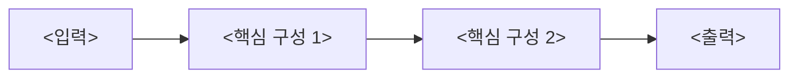
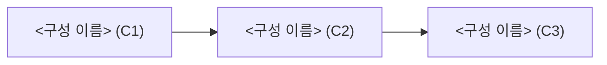
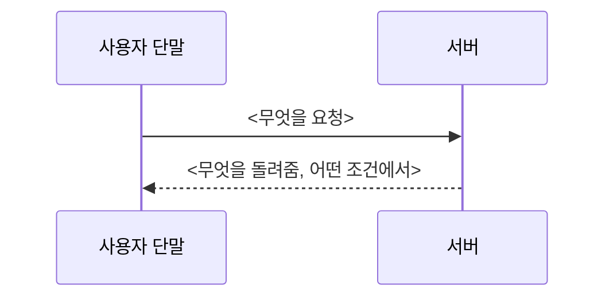
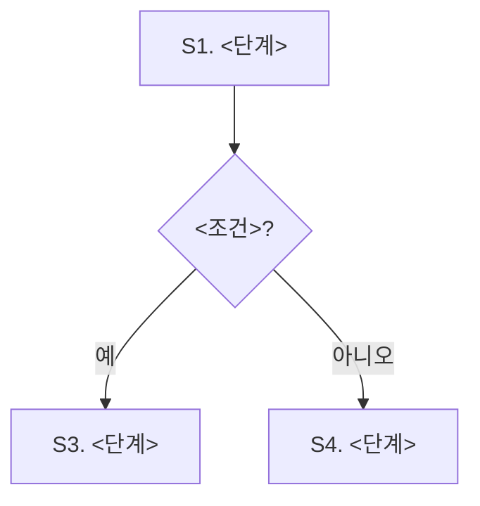

# 기술설명서 양식

기술 하나마다 두 파일을 만든다: 제3자에게 건네는 **기술설명서**(`기술설명서_<짧은 가칭>.md`)와 사내 보관용 **작성 메모**(`작성메모_<짧은 가칭>.md`). 쓰는 요령은 `writing-guide.md`의 절 번호를 따른다.
`<!-- -->` 안의 작성 요령은 결과 파일에서 지운다. 해당 내용이 없으면 절을 지우지 말고 「없음」으로 둔다. 끝의 꼬리말은 바꾸지 않고 그대로 둔다.

---

## 기술설명서

````markdown
# 기술설명서 — <발명의 명칭(가칭)>

> **비밀 — 출원 전 기술 자료.** 이 문서를 비밀유지 의무가 없는 사람에게 건네거나 공개된 곳에 올리면 특허를 받기 어려워질 수 있습니다. 변리사가 아닌 분께는 비밀유지계약(NDA)을 맺은 뒤 건네십시오.

| 항목 | 내용 |
|---|---|
| 회사 | <사용자가 알려 준 경우만 — 아니면 이 행을 지운다> |
| 발명자 후보 | <사용자가 알려 준 경우만 — 아니면 이 행을 지운다> |
| ABC 관리번호 | <사용자가 알려 준 경우만 — 아니면 이 행을 지운다> |
| 작성 | <에이전트·모델명>, <YYYY-MM-DD>, 제<N>판 — 개발 담당자 확인 <전 / 후> |
| 적용 제품·기능 | <일반 명칭으로 — 예: 모바일 촬영 앱의 인물 조명 효과> |
| 구현 상태 | 구현 완료 / 일부 구현 / 설계 단계 |
| 건넬 곳 | 변리사 / 공동개발사·고객 / 투자자 / 사내 기록 |

## 기술 개요
<!-- writing-guide 2절. 3~6문장. 입력 → 핵심 처리 → 출력, 기존과 다른 점. -->



## 1. 해결하고자 하는 과제

### 1-1. 기술 분야와 기존 방식
<!-- writing-guide 3절 1. -->

### 1-2. 기존 방식의 한계
<!-- writing-guide 3절 2. 구체적인 상황, 개발 중 부딪힌 문제, 먼저 시도했다가 버린 방법과 그 이유. -->

### 1-3. 이 발명의 과제
<!-- writing-guide 3절 3. 한두 문장의 기술적 과제. -->

## 2. 발명의 핵심 구성 및 해결 수단

### 2-0. 전체 구성
<!-- writing-guide 4-1. 구성도와 구성 표. mermaid 노드 글자는 큰따옴표로 감싼다. -->



| ID | 구성 | 하는 일 | 입력 | 출력 | 실행 위치 | 구분 |
|---|---|---|---|---|---|---|
| C1 | | | | | 서버 / 단말 / 장비 / 외부 시스템 | 핵심 / 추가 |

### 2-1. <C1 구성 이름>
<!-- writing-guide 4-2. 구성마다 이 하위 목차를 하나씩(2-1, 2-2, …). -->

- **역할**:
- **입력과 출력**:
- **동작 원리**:
- **기준값과 범위**:
- **왜 이렇게 했는가**:
- **변형**:

### 2-2. <C2 구성 이름>

### 2-<N>. 처리 흐름
<!-- writing-guide 4-3. 참여자 사이 순서 → 처리 단계. sequenceDiagram에는 따옴표·세미콜론(;)·#을 쓰지 않는다. -->

**참여자 사이 순서**



| 순서 | 보내는 쪽 → 받는 쪽 | 무엇을 | 조건 |
|---|---|---|---|
| 1 | | | |

**처리 단계**



| 단계 | 수행 주체 | 입력 | 처리 내용 | 출력 | 조건·분기 |
|---|---|---|---|---|---|
| S1 | | | | | |

### 2-<N+1>. 동작 예시 (가상 데이터)
<!-- writing-guide 4-4. 가상 입력 하나를 처음부터 끝까지. 가능하면 기존 방식의 결과와 나란히. -->

| 단계 | 이 발명 | 기존 방식 |
|---|---|---|
| 입력 | | |
| S1 | | |
| 사용자가 받는 것 | | |

## 3. 효과
<!-- writing-guide 5-1. 효과마다 어느 구성 때문인지. 측정값은 조건과 함께, 없으면 「측정값 없음」. -->

| 효과 | 내용 | 관련 구성 | 수치·조건 |
|---|---|---|---|

## 4. 다른 실시 형태
<!-- writing-guide 5-2. 2개 이상. 시도했다가 버린 방법과 이유도. -->

1. **<변형 이름>** —
2. **<변형 이름>** —

## 5. 용어 정리
<!-- 이 문서에서 쓰는 말의 뜻. 내부 명칭은 쓰지 않는다(대응표는 작성 메모). -->

| 용어 | 뜻 |
|---|---|

## 부록 A. 청구항 구성 방향 (안)
<!-- writing-guide 6절. 건넬 곳이 변리사가 아니고 사용자가 빼기로 했으면 이 부록을 작성 메모로 옮기고 「없음(별도 보관)」으로 둔다. -->

> 초안 — 변리사 검토·확정 필요. 권리 범위나 등록 가능성에 대한 판단이 아닙니다.

**관점 1 — <방법 / 장치·시스템 / 기록매체, 실시 주체>**

| 구성 | 초안 문장 | 필수인 이유 |
|---|---|---|
| (a) | | |

**관점 2 — <…>**

**넓게 쓰는 표현**

| 지금 표현 | 넓힌 표현 |
|---|---|

**종속항 후보**

| 후보 | 붙는 관점 | 내용 |
|---|---|---|

**피해 가는 길과 대응**

## 부록 B. 도면 후보
<!-- 명세서 도면으로 쓸 만한 것: 구성도, 참여자 순서도, 처리 흐름도, 화면 예시, 데이터 구조도. 이 문서의 어느 그림·표를 바탕으로 하면 되는지. -->

## 부록 C. 공개 여부
<!-- 추측하지 않는다. 사용자가 답한 것과 에이전트가 찾은 단서만. 건넬 곳이 변리사가 아니고 사용자가 빼기로 했으면 작성 메모로 옮긴다. -->

- 외부 공개: <서비스 출시 / 앱·패키지 배포 / 공개 저장소 / 데모·전시 / 논문·발표 / IR / 고객 납품 — 해당 항목과 날짜, 또는 「사용자 확인 전」>
- 앞으로의 공개 예정: <날짜·방식 또는 「정해지지 않음」>
- 이미 공개했다면 한국은 공개일부터 12개월 안에 공지예외를 주장해 출원할 수 있지만, 해외는 예외가 더 좁을 수 있습니다. 공개 전에 출원하는 것이 가장 안전합니다.

## 수정 이력
<!-- 다시 고칠 때 한 줄씩: 날짜, 판, 바뀐 절. 처음 작성이면 「제1판」 한 줄. -->

---
<sub>이 문서는 ABC 기술설명서 작성 스킬(https://github.com/abciplaw/startup-ip-skills)로 정리한 출원 전 기술 자료입니다. 특허 등록 가능성에 대한 판단이 아니며, 출원 여부와 범위는 변리사와 상담해 정하십시오. 스킬 제작: ABC특허법률사무소 (ABC IP LAW) · https://abcip.co.kr</sub>
````

---

## 작성 메모

````markdown
# 작성 메모 — <발명의 명칭(가칭)>

사내 보관용. 기술설명서 본문의 근거와 확인할 것을 모은다. 변리사에게는 사용자가 원할 때만 함께 보낸다.

| 항목 | 내용 |
|---|---|
| 대상 기술설명서 | 기술설명서_<가칭>.md, 제<N>판 |
| 분석 범위 | <저장소·폴더>, 기준 커밋 <짧은 해시>(<날짜>) / 사용자 제공 문서·시연 파일 / 대화 |
| 읽지 못한 부분 | <다른 저장소, 바이너리, 모델 가중치 등 — 없으면 「없음」> |
| 개발자 질의 | 했음(<날짜>) / 하지 못함 |

## 1. 근거
<!-- 본문의 주장(구성, 기준값, 측정값, 실패한 시도 등)마다 근거 한 줄. -->

| 본문 위치 | 주장 | 근거(경로·커밋·문서·개발자 답변) |
|---|---|---|

## 2. 내부 명칭 대응표

| 본문의 일반 용어 | 프로젝트 내부 명칭 | 위치 |
|---|---|---|

## 3. 확인할 것
<!-- 개발자가 답하지 못했거나 자료로 알 수 없는 것. 측정이 필요하면 무엇을 어떤 조건에서 재면 되는지. -->

- [ ]

## 4. 영업비밀로 뺀 것
<!-- 사용자가 빼 달라고 한 값·데이터·노하우와, 본문에서 어떻게 일반화했는지. 없으면 「없음」. -->

## 5. 공개 단서
<!-- 배포 설정, 릴리스 태그 날짜, 오픈소스 라이선스, README의 서비스 주소 등 에이전트가 찾은 단서. 없으면 「없음」. -->

## 6. 본문에서 옮겨 둔 부록
<!-- 건넬 곳이 변리사가 아니어서 본문에서 뺀 부록 A·C가 있으면 여기에. 없으면 「없음」. -->
````
