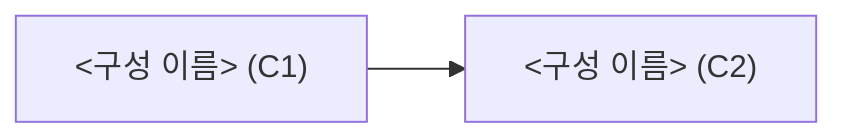
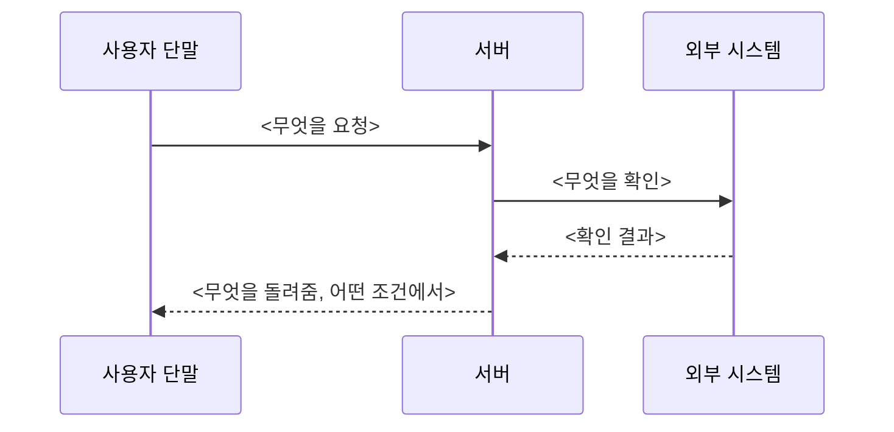
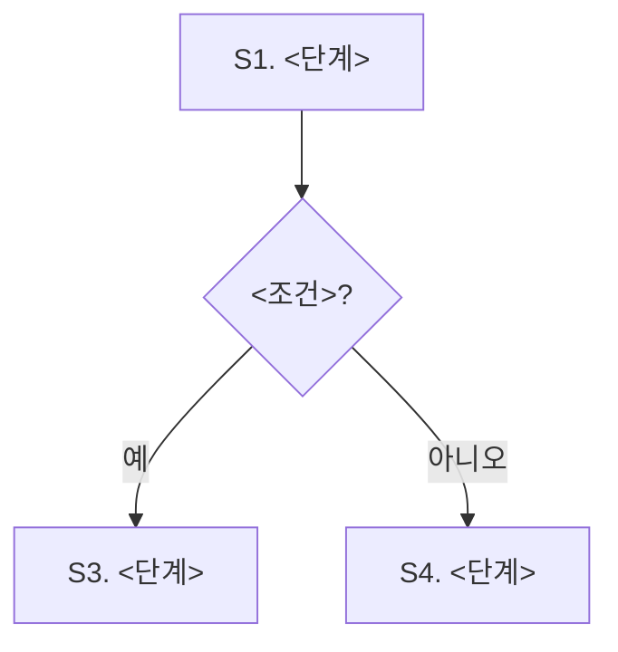

# 발명 기술설명서 양식

발명마다 이 양식으로 파일 하나를 만든다. 파일명: `발명NN_<짧은 가칭>.md` (예: `발명01_문서재정렬.md`).
`<!-- -->` 안의 작성 요령은 결과 파일에서 지운다. 해당 내용이 없으면 절을 지우지 말고 「없음」 또는 `[확인 필요]`로 둔다.

---

````markdown
# 발명 NN. <가칭 발명 명칭>

| 항목 | 내용 |
|---|---|
| 프로젝트 | <프로젝트명> (기준 커밋 <짧은 해시>, <YYYY-MM-DD>) |
| 작성 | <에이전트·모델명>, <YYYY-MM-DD> — 개발자 검토 <전 / 후> |
| ABC 관리번호 | <사용자가 알려 준 경우만 적고, 아니면 이 행을 지운다> |
| 한 줄 요약 | 기존에는 <문제>였는데, 이 발명은 <핵심 수단>으로 <효과>를 얻는다. |
| 발명 유형 | 처리 방법 / 시스템 / 장치 / 데이터 구조 / 학습 방법 / 화면·입력 방식 / 기타 |
| 구현 상태 | 구현 완료 / 일부 구현 / 설계·계획 |
| 공개 여부 | 미공개 / 공개됨(<날짜>, <방식>) / 공개 예정(<날짜>) / [확인 필요] |
| 예비 강도 | 강 / 중 / 약 — <이유 한 줄> (에이전트 예비 의견, 선행조사 전) |
| 판정 | 출원 권장 / 보강 후 검토 — <이유 한 줄> (3절 「특허성 예비 검토」) |
| 포트폴리오 위치 | 원천·핵심 / 응용 / 신사업·해외 — 역할: 제품 방어 / 시장 공격 / 자금 확보 (3절 「포트폴리오에서의 역할」) |
| 우선순위 | A / B / C — <이유 한 줄> |
| 관련 위치 | <모듈·폴더 경로> (코드 원문은 싣지 않음) |

## 1. 기술 분야
<!-- 이 발명이 속한 분야 한두 문장. 넓은 분야 → 좁은 분야 순. -->

## 2. 배경과 해결하려는 문제
<!-- (1) 이 문제를 보통 어떻게 푸는지(일반적인 방법, 알려진 제품·오픈소스의 방식)
     (2) 그 방식의 기술적 한계 — 느리다, 부정확하다, 비싸다, 사람이 손으로 해야 한다 등 구체적으로
     (3) 개발 중 실제로 부딪힌 문제와 그 근거(커밋·이슈·문서). -->

## 3. 핵심 아이디어
<!-- 기존 방식과 다른 점을 1~3개 항목으로. 각 항목은 「무엇을 어떻게 다르게 하는지」 + 「그래서 무엇이 좋아지는지」. -->

**핵심 구성** (하나라도 빠지면 효과가 사라지는 구성): C1, C2, …
**추가 구성** (효과를 키우거나 구체화하는 구성): C5, C6, …

**사용자 흐름 속 위치**: <이 기술이 제품의 어느 사용자 흐름(누가 무엇을 요청하고 무엇을 받는지)의 어느 단계를 바꾸는지. 경쟁사도 같은 서비스를 하려면 이 흐름을 거쳐야 하는지>

### 알려진 기법과 이 발명만의 부분
<!-- discovery-guide 4절. 핵심 구성마다 한 행. 이 표가 예비 강도의 근거다. -->

| 구성 | 그대로 쓴 널리 알려진 기법 | 이 발명만의 부분 |
|---|---|---|
| C1 | <예: 멱등 키, 원자적 파일 교체 — 없으면 「없음」> | <고친 방식·새 조합·이 분야에서 드문 처리 — 없으면 「없음」> |

**예비 강도: 강 / 중 / 약** — <위 표를 근거로 두세 문장. 예비 의견(선행조사 전)>

### 특허성 예비 검토 (변리사 필터, 선행조사 전)
<!-- patentability-filter.md 관문 1~5. 결과마다 근거를 한두 문장으로. 「등록 가능」, 「신규하다」, 등록 확률은 쓰지 않는다. -->

| 관문 | 결과 | 근거 |
|---|---|---|
| 1. 특허 대상인가 (성립성) | 통과 / 위험 / 불통과 | <기술적 과제·기술적 효과가 무엇인지> |
| 2. 공개·공지 위험 (신규성) | 위험 낮음 / 위험 있음 / 위험 큼 | <12절 공개 여부, 표준·널리 쓰이는 방식 그대로인지> |
| 3. 쉽게 떠올릴 수 있는가 (진보성) | 통과 / 경계 / 불통과 | 부정 유형: <해당 유형 또는 없음> / 긍정 요소: <해당 요소와 근거 또는 없음> |
| 4. 권리로 쓸모가 있는가 (실효성) | 문제 없음 / 보강 필요 / 낮음 | <침해 확인, 회피 난이도, 실시 주체> |
| 5. 특허와 영업비밀 | 특허가 나음 / 영업비밀 고려 | <밖에서 알 수 있는지, 가치가 처리 방식에 있는지> |

- **가장 가까운 일반적인 방식**: <한 문장>
- **통상의 기술자 시험**: <「3~5년 경력의 개발자에게 같은 문제를 주면 바로 떠올리겠는가」에 한 문장으로>

**판정: 출원 권장 / 보강 후 검토** — <두세 문장. 예비 의견(선행조사 전)>

**보강 방향** <!-- 「보강 후 검토」면 반드시. 「출원 권장」이어도 더 강하게 만들 방법이 있으면 적는다. -->
- <무엇을 하면(효과 측정, 다른 구성과 결합, 일반적인 과제로 넓히기, 기술적 효과로 다시 설명, 한 주체로 다시 묶기) 어느 관문이 어떻게 나아지는지>

### 포트폴리오에서의 역할
<!-- portfolio-strategy.md 3·4·7·9절. 요약서 4절 「포트폴리오 지도」와 맞춘다. -->

| 항목 | 내용 |
|---|---|
| 층 | 원천·핵심 / 응용 / 신사업·해외 — <이유> |
| 역할 | 제품 방어 / 시장 공격 / 자금 확보(기술력 증빙) — <어느 차별점을 지키는지, 경쟁사가 따라 하고 싶어 하는 기능인지> |
| 입증 유형 | 경쟁 우위형(밖에서 보임) / 기술력 증빙형(내부 처리) — <10절과 연결> |
| 함께 쓸 보호 | <영업비밀로 둘 값·노하우, 디자인·상표·저작권 — 없으면 「없음」> |
| 이어지는 발명 | <같은 포트폴리오에서 이 발명과 결합·종속·후속 관계인 발명 — 없으면 「없음」> |
| 해외 후보 | <개발자가 말한 목표 시장 기준 가안 — 없으면 [확인 필요]> |

## 4. 구성
<!-- 구성도(mermaid flowchart)를 먼저, 이어서 구성요소 표.
     mermaid 문법: 노드 글자는 큰따옴표로 감싼다. 예: A["수집부 (C1)"] --> B["판정부 (C2)"] -->



| ID | 구성(일반 명칭) | 내부 명칭 | 하는 일 | 입력 | 출력 | 실행 위치 | 구분 |
|---|---|---|---|---|---|---|---|
| C1 | | | | | | 서버 / 단말 / 외부 시스템 | 핵심 / 추가 |

## 5. 처리 흐름
<!-- 세 부분으로 쓴다. 5-1 참여자 사이에 무엇이 오가는지, 5-2 처리 단계와 분기, 5-3 사용자가 실제로 받는 것.
     기술 요소만 적고 끝내지 않는다. 요청에서 결과를 받기까지 전체가 보여야 한다(discovery-guide 3절).
     꼭 필요하면 의사코드 10줄 이내. 소스 코드 원문은 쓰지 않는다. -->

### 5-1. 참여자 사이 순서
<!-- 사용자 단말, 다른 사용자 단말, 운영자 단말, 서버, 외부 시스템, 장비 등 참여자마다 세로줄 하나.
     누가 누구에게 무엇을(요청, 데이터, 알림) 어떤 조건에서 보내는지. 사용 경우가 여럿이고 흐름이 다르면 경우마다 따로 그린다.
     참여자가 하나뿐인 발명(장비 내부 처리 등)은 「참여자 하나」라고 적고 5-2로 넘어간다.
     sequenceDiagram에는 따옴표를 쓰지 않고, 세미콜론(;)과 #도 쓰지 않는다. -->



| 순서 | 보내는 쪽 → 받는 쪽 | 무엇을 | 조건 |
|---|---|---|---|
| 1 | | | |

### 5-2. 처리 단계
<!-- 순서도(mermaid)와 단계 표. 이어서 단계별 상세 설명.
     상세 설명에는 판정 규칙, 계산 방법(수식), 순서가 중요한 이유를 쓴다. -->



| 단계 | 수행 주체 | 입력 | 처리 내용 | 출력 | 조건·분기 |
|---|---|---|---|---|---|
| S1 | | | | | |

#### 단계별 상세
- **S1. <단계 이름>** — <무엇을 어떻게 왜>. [근거: <경로>]

### 5-3. 사용자가 받는 것
<!-- 사용자(와 다른 사용자·운영자)가 시점마다 받는 것과 화면에 보이는 것.
     지금까지의 방식에서 받던 것과 무엇이 다른지.
     화면 예시가 있으면 14절 도면 후보에 적는다. 사용자에게 보이는 것이 없는 발명은 그렇다고 적는다. -->

| 시점 | 받는 사람 | 받는 것·화면에 보이는 것 | 기존 방식과 다른 점 |
|---|---|---|---|

## 6. 데이터
<!-- 입력 데이터, 중간 데이터, 출력 데이터, 저장 구조를 필드 수준으로. 예시값은 실제 고객·사용자 데이터가 아닌 가상의 값으로. -->

| 데이터 | 주요 필드 | 만드는 곳 → 쓰는 곳 | 예시(가상) |
|---|---|---|---|

## 7. 조건·기준값·수치
<!-- 임계값, 가중치, 주기, 개수, 시간, 비율 등. 현재값과 가능한 범위, 정한 이유. -->

| 항목 | 현재값 | 가능한 범위 | 정한 이유·근거 | 위치 |
|---|---|---|---|---|

## 8. 대안과 변형
<!-- 권리 범위를 넓히는 데 가장 중요한 절. -->
- **다른 구현 방법** (같은 효과를 다르게 내는 길, 경쟁사가 피해 갈 수 있는 길 — 2개 이상):
- **시도했다가 버린 방법과 이유**:
- **다른 분야·데이터로의 확장**:

## 9. 효과
<!-- 기술적 효과를 먼저(정확도, 속도, 비용, 메모리, 통신량, 안정성, 사람의 작업 감소), 이어서 사용자·사업 효과.
     측정값이 있으면 조건과 근거를 함께. 측정값이 없으면 「측정값 없음」. -->

| 효과 | 내용 | 수치·근거 |
|---|---|---|

## 10. 밖에서 보이는 모습
<!-- 경쟁 제품이 같은 기술을 쓰면 밖에서 어떻게 알아볼 수 있는가 — 화면, API 요청·응답, 공개 문서, 제품 동작, 출력 파일. 밖에서 알 수 없으면 그렇다고 적는다. -->

## 11. 용어
| 프로젝트 내부 용어 | 일반 용어(제안) | 뜻 |
|---|---|---|

## 12. 공개 여부와 일정
<!-- 출원 전에 공개되면 특허를 받기 어려워질 수 있어 변리사가 가장 먼저 보는 절이다. 추측으로 「미공개」라고 쓰지 않는다. -->
- 외부 공개 여부: 서비스 출시 / 앱·패키지 배포 / 공개 저장소 / 데모·전시 / 논문·발표·블로그 / 투자 설명(IR) / 고객 납품 — <해당 항목과 날짜, 또는 [확인 필요]>
- 에이전트가 찾은 단서: <배포 설정, 릴리스 태그 날짜, 오픈소스 라이선스, README의 서비스 주소 등 — 없으면 「없음」>
- 앞으로의 공개 예정: <날짜·방식 또는 [확인 필요]>

## 13. 알려진 유사 기술과 선행조사 키워드
<!-- 에이전트는 검색하지 않는다. 사무소가 선행조사에 쓸 재료만 남긴다(patentability-filter 9절). -->
- 개발자가 아는 유사 제품·논문·특허: <없으면 [확인 필요]>
- 선행조사 키워드: 국문 <…> / 영문 <…> (프로젝트·제품·회사 고유 명칭은 넣지 않는다)
- 분류 후보(추정): <IPC·CPC — 모르면 비워 둔다>

## 14. 변리사에게 전달할 사항
- **도면 후보**: 구성도, 참여자 사이 순서도, 처리 흐름도, 화면 예시, 데이터 구조도 중 이 발명에 필요한 것.
- **[확인 필요] 목록**: 개발자가 답하지 못했거나 자료로 알 수 없는 것.
- **기타 메모**: 영업비밀로 남기고 싶은 부분, 다른 발명과의 관계 등.

---
<sub>ABC 특허 포트폴리오 발굴 스킬로 정리한 기술 자료입니다. 특허 등록 가능성에 대한 판단이 아니며, 출원 여부는 변리사와 상담해 정하십시오. 이 문서를 공개된 곳에 올리면 특허를 받기 어려워질 수 있습니다.</sub>
````
