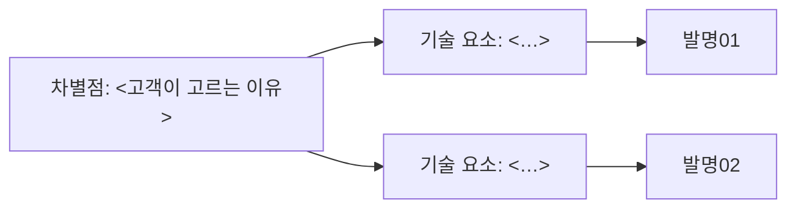
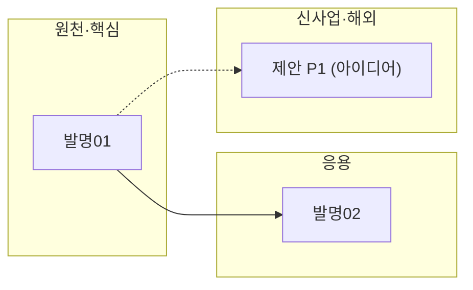

# 포트폴리오 요약 양식

파일명: `00_포트폴리오요약.md`. 가장 먼저 읽히는 파일이다. 발명별 파일을 다 쓴 뒤 마지막에 작성한다. 13절은 8단계(ABC 검토 의뢰 안내)에서 채운다.
`<!-- -->` 안의 작성 요령은 결과 파일에서 지운다. 해당 내용이 없으면 절을 지우지 말고 「없음」 또는 `[확인 필요]`로 둔다.

---

````markdown
# 특허 포트폴리오 발굴 요약 — <프로젝트명>

| 항목 | 내용 |
|---|---|
| 작성 | <에이전트·모델명>, <YYYY-MM-DD>, ABC 특허 포트폴리오 발굴 스킬 0.6.1 |
| ABC 관리번호 | <사용자가 알려 준 경우만 적고, 아니면 이 행을 지운다> |
| 분석 범위 | <저장소·폴더>, 기준 커밋 <짧은 해시>, 커밋 <N>개(<첫 커밋 날짜> ~ <마지막 커밋 날짜>) |
| 분석하지 못한 부분 | <크기·형식 때문에 읽지 못한 폴더, 도면·CAD, 연결된 다른 저장소 — 없으면 「없음」> |
| 대표·개발자 질의 | 했음(<날짜>) / 하지 못함(`[확인 필요]`로 표시) |
| 성장 단계(추정) | 초기 / 성장 / 성숙 — <근거 한 줄> |
| 결과 한눈에 | 출원 권장 <n>건 · 보강 후 검토 <n>건 · 출원 비권장 <n>건 · 추가 발굴 제안 <n>건 |

## 1. 사업과 제품 개요
<!-- 무엇을 하는 제품인지, 고객은 누구이고 왜 이 제품을 고르는지(차별점), 사업 모델, 경쟁 제품·방식, 목표 시장, 현재 단계(개발 중 / 시범 운영 / 출시). 근거가 없는 항목은 [확인 필요]. -->

## 2. 제품–기술 지도
<!-- portfolio-strategy 2절. 차별점 → 기술 요소 → 발명 후보. 코드에서 찾은 후보(아래에서 위로)와 만나는 곳을 보여 준다. -->



| 차별점 | 기술 요소 | 발명 | 근거 |
|---|---|---|---|

## 3. 후보와 특허성 판정

| # | 발명(가칭) | 한 줄 요약 | 예비 강도 | 판정 | 층 | 역할 | 우선순위 | 공개 여부 | 파일 |
|---|---|---|---|---|---|---|---|---|---|
| 01 | | | 강/중/약 | 출원 권장 | 원천·핵심 | 제품 방어 | A | | 발명01_….md |
| 02 | | | | 보강 후 검토 | 응용 | 시장 공격 | B | | 발명02_….md |
| 03 | | | | 출원 비권장 | - | - | - | | 10-1절 |

예비 강도와 판정은 변리사의 특허성 필터(성립성·신규성 위험·진보성·권리 실효성·영업비밀)를 따른 에이전트의 **예비 의견(선행조사 전)**이며, 특허 등록 가능성에 대한 판단이 아니다.

### 3-1. 발명 단위를 이렇게 나눈 이유
<!-- 발명마다 「무엇을 한 발명으로 묶었고, 무엇과는 왜 나눴는지」 한두 문장. -->

## 4. 포트폴리오 지도와 빈 칸
<!-- portfolio-strategy 3·4절. 층마다 발명을 놓고, 빈 칸과 균형(경쟁 우위형/기술력 증빙형)을 적는다. 5절의 추가 발굴 제안은 점선으로. -->



| 층 | 발명 | 상태 |
|---|---|---|
| 원천·핵심 | | 채워짐 / 비어 있음 |
| 응용 | | |
| 신사업·해외 | | |

- **포트폴리오의 중심**: <위에서 아래로와 아래에서 위로가 만나는 발명, 경쟁사가 가장 따라 하고 싶어 하는 기능을 지키는 발명>
- **빈 칸과 균형**: <비어 있는 층, 경쟁 우위형·기술력 증빙형 중 빠진 쪽>
- **전략 위치**: 경쟁 강도 <높음/낮음> × 경쟁력에서 기술의 기여 <높음/낮음> → <portfolio-strategy 방향 한 줄> (추정)

## 5. 추가 발굴 제안 (아이디어 단계 — 개발자 검토 필요)
<!-- portfolio-strategy 5절. 코드에 아직 없는 후보. 처리 방식을 구체화하면 발명 파일로 옮길 수 있다. -->

| # | 채울 빈 칸 | 아이디어 | 근거·출처 | 구체화에 필요한 것 |
|---|---|---|---|---|
| P1 | 신사업·해외 / 응용 / 경쟁사의 빠진 고리 / 개량 | | 로드맵·이슈·개발자 답변 | |

## 6. 성장 단계별 할 일과 출원 순서·예산
<!-- portfolio-strategy 6·8절. 비용 금액, 지원사업 조건, 세제 혜택 같은 바뀌는 숫자는 쓰지 않는다. -->

| 순서 | 발명 | 예산 성격 | 시점(공개 예정 기준) | 방식 |
|---|---|---|---|---|
| 1 | | 필수 방어 / 공격용 진입장벽 / 미래 옵션 | <YYYY-MM 전> | 정규 출원 / 임시 명세서 출원 / 국내우선권으로 추가 |

- **이 단계에서 할 일**: <성장 단계에 맞는 두세 가지 — 예: 임시 명세서 출원으로 출원일 확보, 상표 출원, 특허–제품 매칭표, 경쟁사 모니터링, 상장 대비 점검>

## 7. 해외 권리화 가안
<!-- portfolio-strategy 7절. 개발자가 말한 목표 시장·경쟁사 위치 기준. 국가 선택과 일정은 변리사와 정한다. -->

| 나라 | 이유(매출 / 경쟁사 / 투자·인수합병) | 대상 발명 | 경로(직접 출원 / PCT) |
|---|---|---|---|

## 8. 특허 밖의 보호 (IP-Mix)
<!-- portfolio-strategy 9절. 영업비밀로 둘 값·노하우, 디자인·상표·저작권. -->

| 대상 | 보호 수단 | 이유 |
|---|---|---|

## 9. 투자·IR용 설명 초안
<!-- portfolio-strategy 11절. 숫자만 나열하지 않는다. 수치는 측정값만(조건과 함께), 없으면 [확인 필요]. -->

- **핵심 가치**: <어떤 핵심 기술을 몇 건으로 특허화(예정)했는가 — 층별로>
- **경쟁 우위**: <특허가 지키는 차별점과 측정된 효과>
- **사업 전략과의 연결**: <목표 시장·국가, 다음 제품 업데이트와 관련 출원 계획>
- **위험 관리**: <실제로 하고 있거나 할 것만>

| 제품·기능 | 지키는 발명 | 층 | 상태(출원 예정·출원·등록) | 나라 |
|---|---|---|---|---|

## 10. 출원 비권장 후보와 제외한 항목

### 10-1. 출원 비권장 (특허성 필터에서 걸린 후보)

| 후보 | 한 줄 요약 | 걸린 관문 | 이유 | 대안(흡수 / 영업비밀 / 보류) |
|---|---|---|---|---|

### 10-2. 특허 대상이 아니라 제외한 항목

| 항목 | 위치 | 제외 이유 |
|---|---|---|

## 11. 더 찾아볼 부분과 위험
<!-- 자료가 부족해 판단하지 못한 영역, 연결된 다른 저장소, 개발자에게 더 들어야 할 것.
     걱정되는 경쟁사 특허가 있으면 「변리사의 침해 검토(FTO) 권장」으로 적는다. 에이전트는 침해 여부를 판단하지 않는다.
     오픈소스 사용·공개, 데이터 사용 권한처럼 특허 밖의 확인 사항도 여기에. -->

## 12. 공개 여부와 일정
<!-- 발명별 공개 여부를 모은다. 이미 공개되었거나 곧 공개될 기술이 있으면 맨 위에 굵게 적는다. 아래 세 안내는 그대로 둔다. -->

- **공개 전에 출원하십시오.** 출시·발표·IR·정부 과제 발표·논문·공개 저장소 게시 전에 출원하는 것이 가장 안전합니다. 이미 공개했다면 한국·미국은 공개일부터 1년 안에 예외를 주장해 출원할 수 있지만, 유럽·중국 등은 예외가 매우 좁아 해외 출원이 막힐 수 있습니다. 급하면 임시 명세서 출원으로 출원일부터 확보할 수 있습니다.
- **핵심부터 먼저.** 원천·핵심 특허를 먼저 출원하고, 1년 안에 개량 내용을 더해 다시 출원하는 국내우선권 제도로 묶을 수 있습니다.
- **이 폴더를 공개하지 마십시오.** 공개 저장소, 이슈, 블로그, 커뮤니티, 생성형 AI 공유 링크에 올리면 그 자체로 공개가 됩니다. 비밀유지 의무가 있는 변리사에게만 보내십시오.

## 13. ABC 검토 의뢰
<!-- 8단계에서 사용자가 의뢰하겠다고 하면 사용자가 알려 준 값으로 채운다. 의뢰하지 않으면 표를 지우고 아래 한 줄만 남긴다.
     「의뢰하지 않음 — 검토를 원하시면 이 폴더를 압축해 abcip@abcip.co.kr로 보내 주십시오(ABC특허법률사무소 https://abcip.co.kr).」 -->

| 항목 | 내용 |
|---|---|
| 회사명 | |
| 담당자 | |
| 연락 메일 | |
| 전화 | |
| 발명자 후보 (발명별) | |
| 출시·발표·투자 설명 일정 | |
| ABC 관리번호 | |
| 개발 담당자 확인 | 내용을 읽고 틀린 곳을 고쳤음 / 영업비밀로 남길 부분을 지웠음 |
| 압축 파일 | patent-portfolio/ABC의뢰_<YYYYMMDD>.zip (사용자가 직접 메일로 보냄) |

---
<sub>이 문서는 ABC 특허 포트폴리오 발굴 스킬(https://github.com/abciplaw/startup-ip-skills)로 정리했습니다. 특허 등록 가능성에 대한 판단이 아니며, 출원 여부와 범위, 국가와 일정은 변리사와 상담해 정하십시오. 스킬 제작: ABC특허법률사무소 (ABC IP LAW) · https://abcip.co.kr · abcip@abcip.co.kr</sub>
````
