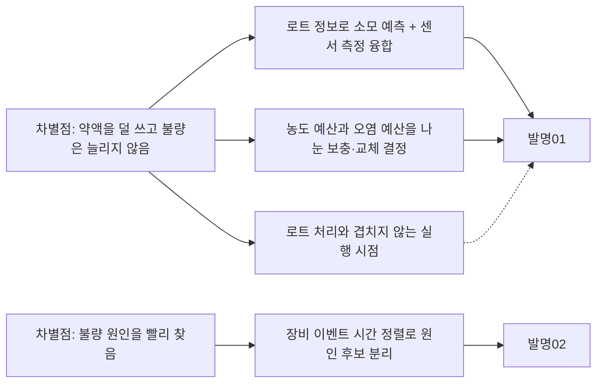
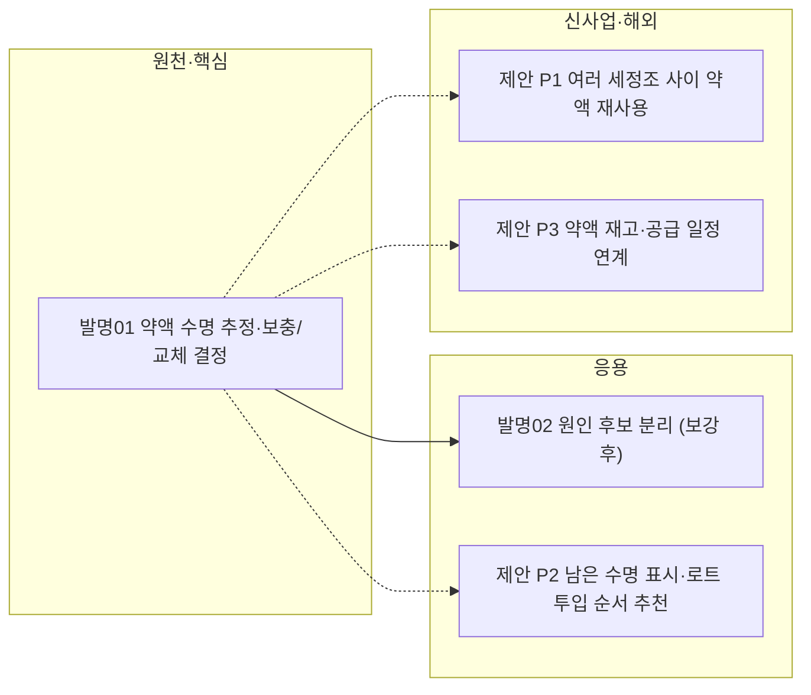

# 특허 포트폴리오 발굴 요약 — wetbench-monitor (가상 예시)

> **가상 예시입니다.** 실존 회사·제품·특허와 관계없이, 이 스킬의 결과물이 어떤 모양인지 보여 드리려고 만든 것입니다. 수치와 답변도 모두 가상입니다.

| 항목 | 내용 |
|---|---|
| 작성 | Claude, 2026-11-14, ABC 특허 포트폴리오 발굴 스킬 0.5.0 |
| 분석 범위 | 저장소 wetbench-monitor 전체, 기준 커밋 a1b2c3d, 커밋 412개(2025-09-01 ~ 2026-11-10) |
| 분석하지 못한 부분 | `hw/` 폴더의 센서 브래킷 CAD 파일(형식상 읽을 수 없음), 장비 제어기 펌웨어(별도 저장소) |
| 대표·개발자 질의 | 했음(2026-11-14) |
| 성장 단계(추정) | 성장 초입 — 시범 운영 1곳, 2027-01 전시회 시연, 2027 상반기 투자 유치 준비(개발자 답변) |
| 결과 한눈에 | 출원 권장 1건 · 보강 후 검토 1건 · 출원 비권장 1건 · 추가 발굴 제안 3건 |

## 1. 사업과 제품 개요
- **제품**: 반도체 습식 세정 장비(배치형 세정조)의 약액 상태를 감시하고 보충·교체 시점을 정하는 소프트웨어. 장비 옆 산업용 PC에서 동작한다.
- **고객과 선택 이유**: 팹의 세정 공정·장비 엔지니어. 약액 비용을 줄이면서 세정 불량을 늘리지 않는다는 점(개발자 답변).
- **사업 모델**: 세정조 단위 소프트웨어 라이선스(개발자 답변).
- **경쟁**: 장비 제조사가 기본으로 넣는 고정 주기 자동 보충·교체 기능. 경쟁사가 가장 따라 하고 싶어 할 기능은 「보충과 교체를 나눠 결정하는 것」이라는 답변.
- **목표 시장**: 국내 시범 운영 후 대만·미국 팹(개발자 답변).

## 2. 제품–기술 지도

| 차별점 | 기술 요소 | 발명 | 근거 |
|---|---|---|---|
| 약액을 덜 쓰고 불량은 늘리지 않음 | 로트 기반 소모 예측, 예측·측정 융합 | 01 | `core/life_model/`, 커밋 이력 |
| 같은 차별점 | 농도·오염 예산 분리 결정 | 01 | `core/decision/` |
| 같은 차별점 | 실행 시점 조정 | 01의 추가 구성(03을 흡수) | `core/decision/scheduler` |
| 불량 원인을 빨리 찾음 | 이벤트 시간 정렬, 원인별 지연 시간 창 | 02 | `diagnosis/` |

## 3. 후보와 특허성 판정

| # | 발명(가칭) | 한 줄 요약 | 예비 강도 | 판정 | 층 | 역할 | 우선순위 | 공개 여부 | 파일 |
|---|---|---|---|---|---|---|---|---|---|
| 01 | 로트 정보 기반 약액 유효 수명 추정과 보충·교체 결정 | 로트의 막 종류·노출 면적으로 소모를 예측하고 센서 측정으로 보정해, 농도 부족은 부분 보충으로, 오염 누적은 전체 교체로 나눠 결정 | 중~강 | 출원 권장 | 원천·핵심 | 제품 방어 + 시장 공격 | A | 미공개(비밀유지 계약하 시범 운영), 2027-01 전시회 예정 | 발명01_약액유효수명추정.md |
| 02 | 파티클 급증 원인 후보 분리 | 파티클 계수가 급증하면 약액 보충·필터 교체·이송 로봇 이벤트를 시간 축에 맞춰 원인 후보 순위를 매김 | 중 | 보강 후 검토 | 응용 | 자금 확보(기술력 증빙) | B | 미공개 | (예시에서는 생략) |
| 03 | 교체 작업 지시 자동 생성 | 교체 결정이 나면 작업 지시서와 알림을 만들고 생산 일정과 겹치지 않는 시간을 제안 | 약 | 출원 비권장 | - | - | - | 미공개 | 10-1절 |

예비 강도와 판정은 변리사의 특허성 필터(성립성·신규성 위험·진보성·권리 실효성·영업비밀)를 따른 에이전트의 **예비 의견(선행조사 전)**이며, 특허 등록 가능성에 대한 판단이 아니다.

### 3-1. 발명 단위를 이렇게 나눈 이유
- **01**은 「약액을 언제, 얼마나 보충하거나 바꿀지」라는 과제 하나로 묶었다. 소모 예측, 센서 보정, 보충·교체 결정은 함께 있어야 효과가 난다.
- **02**는 결과(파티클 증가)의 원인을 찾는 진단 과제라 01과 나눴다. 01의 보충 이력을 입력으로 쓰지만 독립적으로 쓸 수 있다.
- **03**은 01의 결정을 받아 작업으로 바꾸는 운영 기능이다. 따로 떼면 약해서 01에 흡수했다.

## 4. 포트폴리오 지도와 빈 칸

| 층 | 발명 | 상태 |
|---|---|---|
| 원천·핵심 | 01 | 채워짐 |
| 응용 | 02(보강 후) | 일부 — 고객 화면에서 보이는 응용 특허가 없음 |
| 신사업·해외 | 없음 | 비어 있음 — 로드맵에 후보 있음 |

- **포트폴리오의 중심**: 01. 사업에서 내려온 차별점과 코드에서 올라온 후보가 같은 곳에서 만나고, 경쟁사가 가장 따라 하고 싶어 할 기능이라는 답변과도 맞는다.
- **빈 칸과 균형**: 01·02 모두 장비 내부 처리라 기술력 증빙 쪽에 가깝다. 경쟁 제품이 쓰는지 밖에서 바로 알아볼 수 있는 **경쟁 우위형(화면·출력)** 특허가 없다. 신사업 층도 비어 있다.
- **전략 위치**: 경쟁 강도 높음(장비 제조사 기본 기능과 경쟁) × 경쟁력에서 기술의 기여 높음 → 공격적 특허 전략과 R&D·IP 통합이 맞다. (추정)

## 5. 추가 발굴 제안 (아이디어 단계 — 개발자 검토 필요)

| # | 채울 빈 칸 | 아이디어 | 근거·출처 | 구체화에 필요한 것 |
|---|---|---|---|---|
| P1 | 신사업 | 여러 세정조 사이에서 오염 예산이 남은 약액을 다른 조로 옮겨 쓰는 결정 | 로드맵 「약액 재사용」 | 옮기는 조건(농도·오염·공정 호환), 배관·장비 동작 |
| P2 | 응용(경쟁 우위형) | 작업자 화면에 세정조별 남은 수명과 다음 보충 예정을 보여 주고, 남은 수명에 맞춰 로트 투입 순서를 추천 | 개발자 답변(현장 요청) | 화면 흐름, 추천 규칙, 01과의 연결 |
| P3 | 경쟁사의 빠진 고리 | 고객 입장에서 보면 교체 결정 뒤 약액 재고·공급 일정은 사람이 따로 맞춘다. 교체·보충 예측을 약액 재고와 공급 일정에 잇는 처리 | 개발자 답변(고객 불편) | 예측 기간, 재고 시스템과 주고받는 데이터 |

## 6. 성장 단계별 할 일과 출원 순서·예산

| 순서 | 발명 | 예산 성격 | 시점(공개 예정 기준) | 방식 |
|---|---|---|---|---|
| 1 | 01 | 필수 방어 + 공격용 진입장벽 | 2027-01 전시회 전(2026-12 중) | 정규 출원. 일정이 빠듯하면 지금의 설계 문서로 임시 명세서 출원을 먼저 하고 1년 안에 보완 |
| 2 | P2(구체화 후) | 공격용 진입장벽(경쟁 우위형) | 01 출원 후 1년 안 | 01에 국내우선권으로 더하거나 따로 출원 |
| 3 | 02(보강 후) | 필수 방어 | 2027 상반기 | 따로 출원 또는 국내우선권 |
| 4 | 01의 PCT | 미래 옵션 | 01 출원 후 12개월 안 | PCT 국제출원 |

- **이 단계에서 할 일**: 01 출원을 전시회 일정에 맞추기 / 제품명 상표를 전시회 전에 출원 / 투자 실사에 대비해 특허–제품 매칭표(9절)를 유지 / 장비 제조사의 출원을 정기적으로 보는 경쟁사 모니터링을 변리사와 검토.

## 7. 해외 권리화 가안

| 나라 | 이유 | 대상 발명 | 경로 |
|---|---|---|---|
| 대만 | 매출 예정(고객 팹) | 01 | PCT 후 진입 |
| 미국 | 매출 예정, 투자 시장 | 01, P2 | PCT 후 진입 |
| 일본 | 경쟁 장비 제조사 위치 | 01 | PCT 기간 안에 결정 |

목표 시장이 아직 바뀔 수 있어 PCT로 나라 결정을 미루는 가안이다. 나라와 일정은 변리사와 정한다.

## 8. 특허 밖의 보호 (IP-Mix)

| 대상 | 보호 수단 | 이유 |
|---|---|---|
| 막 종류별 소모 계수 값 | 영업비밀 | 가치가 값 자체에 있고 밖에서 알 수 없음. 명세서에는 예시값만 |
| 원인별 지연 시간 창 값(02) | 영업비밀 | 같은 이유 |
| 제품명 | 상표 | 전시회·영업 전에 확보 |
| 센서 브래킷 형상 | 특허 또는 디자인 검토 | 도면 확인 전이라 보류(11절) |

## 9. 투자·IR용 설명 초안

- **핵심 가치**: 약액 수명 추정과 보충·교체 결정이라는 핵심 기술을 원천·핵심 특허로 출원 예정이며, 진단·작업자 화면 같은 응용 특허를 이어서 준비 중.
- **경쟁 우위**: 시범 라인에서 약액 사용량 31 % 감소, 파티클 기준 초과 웨이퍼 비율 0.8 % → 0.3 %(2026-10 측정, 개발자 답변).
- **사업 전략과의 연결**: 대만·미국 고객 팹을 목표로 PCT 출원을 계획.
- **위험 관리**: 아직 없음 — 경쟁 장비 제조사 출원 모니터링을 검토 중 `[확인 필요]`.

| 제품·기능 | 지키는 발명 | 층 | 상태 | 나라 |
|---|---|---|---|---|
| 약액 수명 추정·보충/교체 | 01 | 원천·핵심 | 출원 예정 | KR → PCT |
| 원인 진단 | 02 | 응용 | 보강 후 검토 | KR |
| 작업자 화면(계획) | P2 | 응용 | 아이디어 | - |

## 10. 출원 비권장 후보와 제외한 항목

### 10-1. 출원 비권장 (특허성 필터에서 걸린 후보)

| 후보 | 한 줄 요약 | 걸린 관문 | 이유 | 대안 |
|---|---|---|---|---|
| 03 교체 작업 지시 자동 생성 | 교체 결정을 작업 지시서·알림으로 바꾸고 빈 시간을 제안 | 관문 3 (진보성) | 사람이 하던 작업 지시를 규칙 표와 일정 조회로 옮긴 「업무의 시스템화」에 가깝다. | 01의 C6 종속 구성으로 흡수 |

### 10-2. 특허 대상이 아니라 제외한 항목

| 항목 | 위치 | 제외 이유 |
|---|---|---|
| 장비 통신 드라이버 | `drivers/secsgem/` | 표준 통신 규격을 오픈소스 라이브러리로 구현 |
| 사용자 로그인·권한 | `web/auth/` | 표준 기능 |
| 일일 보고서 PDF | `reports/` | 일반 문서 생성 |
| 온도 보상 계산 | `sensing/temp_comp.py` | 전도도의 표준 온도 보상식을 그대로 사용(01의 추가 구성으로만 언급) |

## 11. 더 찾아볼 부분과 위험
- `hw/`의 센서 브래킷 설계: 기포가 센서에 붙지 않게 하는 각도가 있다는 답변. CAD를 읽지 못해 판단하지 못했다. 도면과 함께 변리사와 상의할 것.
- 장비 제어기 펌웨어는 별도 저장소라 보지 않았다. 그 저장소에서도 이 스킬을 실행하기를 권한다.
- 장비 제조사에 자동 보충 관련 특허가 있는지 모른다는 답변. 출시·전시 전에 **변리사의 침해 검토(FTO)**를 권한다.
- `drivers/secsgem/`에 쓴 오픈소스 라이브러리의 라이선스 조건을 배포 전에 확인할 것.

## 12. 공개 여부와 일정
- **2027년 1월 전시회에서 시연할 계획이 있다(개발자 답변). 01은 그 전에 출원해야 한다.**
- 01~03 모두 고객사 라인에서 시범 운영 중이다(2026-08부터). 비밀유지 계약을 맺었다는 답변. 고객사가 시범 운영 자료를 외부에 발표할 계획이 있는지 확인이 필요하다 `[확인 필요]`.
- 저장소는 비공개이며 오픈소스 라이선스 파일은 없다.

- **공개 전에 출원하십시오.** 출시·발표·IR·정부 과제 발표·논문·공개 저장소 게시 전에 출원하는 것이 가장 안전합니다. 이미 공개했다면 한국·미국은 공개일부터 1년 안에 예외를 주장해 출원할 수 있지만, 유럽·중국 등은 예외가 매우 좁아 해외 출원이 막힐 수 있습니다. 급하면 임시 명세서 출원으로 출원일부터 확보할 수 있습니다.
- **핵심부터 먼저.** 원천·핵심 특허를 먼저 출원하고, 1년 안에 개량 내용을 더해 다시 출원하는 국내우선권 제도로 묶을 수 있습니다.
- **이 폴더를 공개하지 마십시오.** 공개 저장소, 이슈, 블로그, 커뮤니티, 생성형 AI 공유 링크에 올리면 그 자체로 공개가 됩니다. 비밀유지 의무가 있는 변리사에게만 보내십시오.

## 13. ABC 검토 의뢰

의뢰하지 않음 — 검토를 원하시면 이 폴더를 압축해 abcip@abcip.co.kr로 보내 주십시오(ABC특허법률사무소 https://abcip.co.kr). (가상 예시라 의뢰 정보를 비워 두었습니다. 실제로 의뢰하면 이 절에 회사명·담당자·압축 파일 이름이 적힙니다.)

---
이 문서는 ABC 특허 포트폴리오 발굴 스킬(https://github.com/abciplaw/startup-ip-skills)로 정리했습니다. 특허 등록 가능성에 대한 판단이 아니며, 출원 여부와 범위, 국가와 일정은 변리사와 상담해 정하십시오. 스킬 제작: ABC특허법률사무소 (ABC IP LAW) · https://abcip.co.kr · abcip@abcip.co.kr
