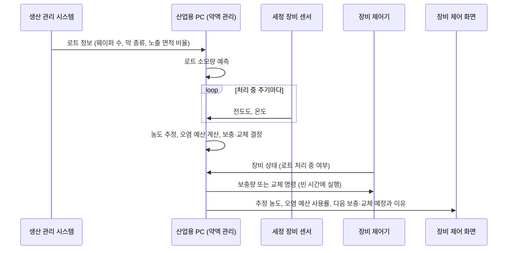
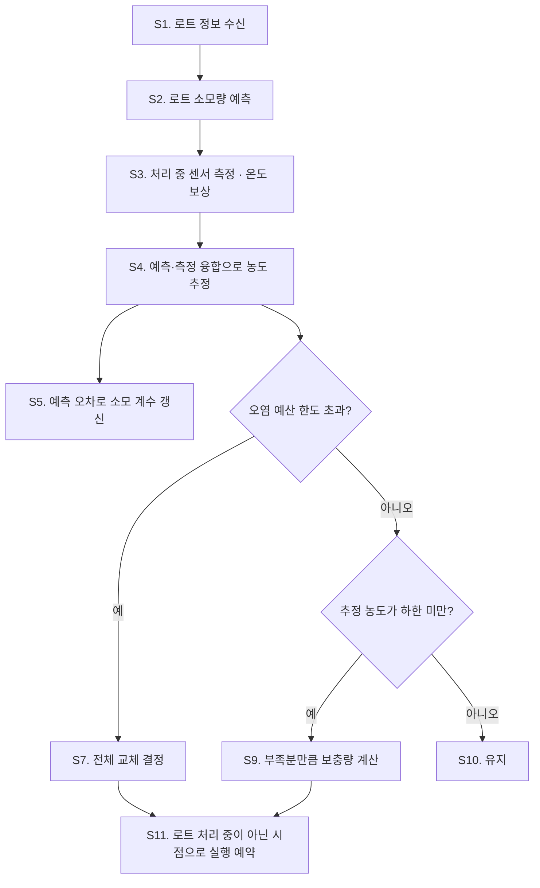

# 발명 01. 로트 정보에 기초한 세정 약액의 유효 수명 추정과 보충·교체 결정 방법

> **가상 예시입니다.** 실존 회사·제품·특허와 관계없으며 수치도 모두 가상입니다.

| 항목 | 내용 |
|---|---|
| 프로젝트 | wetbench-monitor (기준 커밋 a1b2c3d, 2026-11-10) |
| 작성 | Claude, 2026-11-14 — 개발자 검토 전 |
| 한 줄 요약 | 기존에는 세정 약액을 정해진 시간이나 처리 매수마다 바꾸거나 보충했는데, 이 발명은 투입 로트의 막 종류와 노출 면적으로 약액 소모를 예측하고 농도 센서 측정으로 보정한 뒤, 농도 부족과 오염 누적을 따로 관리해 부족분은 부분 보충으로, 오염 한도 초과만 전체 교체로 결정한다. |
| 발명 유형 | 처리 방법 / 장비 제어 시스템 |
| 구현 상태 | 구현 완료 (시범 운영 중) |
| 공개 여부 | 미공개 — 2026-08부터 고객사 1곳에서 비밀유지 계약하에 시범 운영, 2027-01 전시회 시연 예정 |
| 예비 강도 | 중~강 — 개별 기법은 알려져 있으나, 로트 정보로 소모를 예측해 측정과 융합하고 농도·오염 예산을 나눠 보충과 교체를 가르는 결합은 일반적인 고정 주기 방식과 분명히 다름 (에이전트 예비 의견, 선행조사 전) |
| 판정 | 출원 권장 — 결합 효과와 측정된 효과, 버린 방법의 기록이 있음 (3절 「특허성 예비 검토」) |
| 포트폴리오 위치 | 원천·핵심 — 역할: 제품 방어 + 시장 공격 (3절 「포트폴리오에서의 역할」) |
| 우선순위 | A — 약액 비용과 세정 불량에 직결되고, 전시회 시연 전에 출원이 필요함 |
| 관련 위치 | `core/life_model/`, `core/decision/`, `sensing/`, `config/consumption.yaml` |

## 1. 기술 분야
반도체 웨이퍼 습식 세정 장비에서 세정 약액의 상태를 추정하고 보충·교체를 제어하는 기술에 관한 것이다.

## 2. 배경과 해결하려는 문제
- **보통 방식**: 세정조의 약액은 「24시간마다 교체」, 「200매 처리 후 교체」처럼 고정 주기로 바꾸고, 정해진 간격으로 일정량을 보충한다. 농도 센서가 있어도 경보용으로만 쓴다. [근거: docs/background.md]
- **한계 1 — 로트마다 소모가 다르다.** 산화막이 많이 드러난 웨이퍼와 그렇지 않은 웨이퍼는 같은 1매라도 약액을 다르게 소모한다. 고정 주기는 가장 나쁜 경우에 맞춰 짧게 잡혀 약액을 낭비하거나, 반대로 소모가 많은 로트가 몰리면 농도가 먼저 떨어진다. [근거: 커밋 3f2e… 「막 종류별 소모 차이 반영」]
- **한계 2 — 센서만으로는 늦고 흔들린다.** 전도도 측정은 온도·기포에 흔들리고, 농도가 떨어진 뒤에야 알려 준다.
- **한계 3 — 보충으로 해결되지 않는 열화가 있다.** 보충은 농도를 되돌리지만 녹아 나온 금속·입자는 그대로 쌓인다. 농도만 보고 보충을 거듭하면 오염이 쌓인 약액을 계속 쓰게 된다.

## 3. 핵심 아이디어
1. **로트 정보로 소모를 미리 예측한다.** 생산 관리 시스템에서 받은 로트의 웨이퍼 수, 막 종류, 노출 면적 비율에 막 종류별 소모 계수를 곱해, 로트를 넣기 전에 그 로트가 쓸 약액 양을 예측한다.
2. **예측과 측정을 융합한다.** 예측한 농도와 온도 보상한 전도도 측정값을 측정 신뢰도에 따라 가중 결합해 현재 농도를 추정하고, 그 오차로 소모 계수를 조금씩 고친다.
3. **농도 예산과 오염 예산을 나눈다.** 농도 부족은 부분 보충(필요량 계산)으로 해결하고, 처리 면적에 비례해 쌓이는 오염 추정치가 한도를 넘을 때만 전체 교체를 결정한다. 보충과 교체는 로트 처리 중이 아닌 시점으로 미룬다.

**핵심 구성**: C1, C2, C3, C4
**추가 구성**: C5, C6

**사용자 흐름 속 위치**: 생산 관리 시스템이 로트 정보를 보내고 → 장비가 세정하는 동안 약액 상태를 추정하고 → 설비 엔지니어가 보충·교체 예정과 그 이유를 받는 흐름 가운데, 「언제 얼마나 보충하고 언제 바꿀지」를 정하는 단계를 바꾼다. 같은 기능을 내세우는 장비라면 로트 정보 수신과 보충·교체 실행 사이의 이 결정 단계를 거쳐야 한다. (추정)

### 알려진 기법과 이 발명만의 부분

| 구성 | 그대로 쓴 널리 알려진 기법 | 이 발명만의 부분 |
|---|---|---|
| C1 소모 예측부 | 처리 매수 기반 소모 계산 | 막 종류·노출 면적별 소모 계수를 로트 정보에 적용해 로트 투입 전에 예측 |
| C2 상태 추정부 | 전도도 온도 보상, 칼만 필터식 가중 결합 | 예측 오차로 막 종류별 소모 계수를 온라인 갱신 |
| C3 오염 누적부 | 없음 | 처리 면적에 비례하는 오염 예산을 농도와 따로 관리 |
| C4 보충·교체 결정부 | 정량 보충 펌프 제어 | 농도 예산 → 보충량, 오염 예산 → 교체로 나누는 결정 규칙 |

**예비 강도: 중~강** — 전도도 측정, 온도 보상, 가중 결합은 널리 쓰이는 기법이다. 그러나 로트 정보로 소모를 예측해 측정과 융합하고, 그 오차로 막 종류별 계수를 고치며, 농도와 오염을 나눠 보충과 교체를 가르는 결합은 고정 주기 방식과 처리 방식 자체가 다르다. 같은 결합의 선행 기술이 있는지는 선행조사로 확인해야 한다. (예비 의견, 선행조사 전)

### 특허성 예비 검토 (변리사 필터, 선행조사 전)

| 관문 | 결과 | 근거 |
|---|---|---|
| 1. 특허 대상인가 (성립성) | 통과 | 장비 센서 측정과 로트 정보로 약액 상태를 추정해 보충 펌프와 교체를 제어하는 구체적인 처리다. 효과가 약액 사용량과 파티클 불량률이라는 기술적 효과로 나타난다. |
| 2. 공개·공지 위험 (신규성) | 위험 낮음 (일정 주의) | 시범 운영은 비밀유지 계약을 맺은 고객사 1곳에 한정되어 보통은 공개로 보지 않지만, 계약 범위와 고객사의 발표 계획은 확인해야 한다 `[확인 필요]`. 2027-01 전시회 시연 전에 출원해야 한다. 고정 주기 교체·정량 보충은 널리 쓰이지만 이 발명의 결합과는 다르다. |
| 3. 쉽게 떠올릴 수 있는가 (진보성) | 통과 (결합 선행 기술 확인 필요) | 부정 유형: 온도 보상, 가중 결합, 정량 보충은 각각 알려져 있어 「단순 결합」으로 볼 위험이 있다. / 긍정 요소: 예측·측정 융합이 기포로 인한 오보충을 막고, 오염 예산 분리가 보충만 반복해 오염된 약액을 쓰는 문제를 막아 구성들이 서로 영향을 준다(결합 효과). 약액 사용량 31 % 감소, 불량 비율 0.8 % → 0.3 %(측정 효과). 센서만으로 보충하다 되돌린 기록(다른 방법의 실패). |
| 4. 권리로 쓸모가 있는가 (실효성) | 보강 필요 (작음) | 장비 사양서·제어 화면·보충 이력으로 확인할 수 있고, 핵심 처리를 산업용 PC 한 곳(한 주체)에서 표현할 수 있다. 다만 C1을 「막 종류별 계수」로 좁게 쓰면 회귀 모델 같은 대안(8절)으로 쉽게 피해 간다. |
| 5. 특허와 영업비밀 | 특허가 나음 (계수 값은 영업비밀) | 동작이 장비 사양과 보충 이력으로 드러나 특허가 낫다. 막 종류별 계수 값 자체는 영업비밀로 남긴다. |

- **가장 가까운 일반적인 방식**: 시간이나 처리 매수에 따른 고정 주기 교체와, 농도 센서 경보에 따른 정량 보충.
- **통상의 기술자 시험**: 센서로 농도를 보고 보충하는 것은 바로 떠올리겠지만, 로트 정보로 미리 소모를 예측해 측정과 융합하고, 보충으로 줄지 않는 오염을 따로 예산으로 두어 교체만 그것으로 정하는 구성은 「농도가 떨어지면 보충하면 된다」는 통념 때문에 바로 떠올리기 어렵다. (추정)

**판정: 출원 권장** — 처리 방식 자체가 고정 주기 방식과 다르고, 결합 효과·측정 효과·버린 방법의 기록이 진보성 근거로 갖춰져 있다. 전시회 일정 때문에 출원이 급하다. (예비 의견, 선행조사 전)

**보강 방향**
- 소모 예측을 「막 종류별 계수」가 아니라 「로트 정보로 약액 소모를 예측하는 것」으로 넓게 표현하고, 계수 방식과 회귀 모델 방식을 모두 실시예로 넣는다(관문 4).
- 오염 예산 분리(C3)를 독립항의 핵심 구성으로 둘지 변리사와 상의한다. 기존 방식과 가장 뚜렷하게 다른 부분이다(관문 3).
- 기포 급변 구간 처리 전후의 오보충 횟수를 측정해 두면 효과 근거가 하나 더 생긴다(관문 3).
- 식각액·도금액·연마 슬러리 적용(8절)과 발명03의 「생산 일정과 겹치지 않는 실행 시점」을 실시예·종속 구성으로 넣는다.

### 포트폴리오에서의 역할

| 항목 | 내용 |
|---|---|
| 층 | 원천·핵심 — 제품의 차별점(약액을 덜 쓰고 불량은 늘리지 않음)을 이루는 처리 자체 |
| 역할 | 제품 방어 + 시장 공격 — 경쟁사가 가장 따라 하고 싶어 할 기능이 「보충과 교체를 나눠 결정하는 것」이라는 답변 |
| 입증 유형 | 기술력 증빙 쪽에 가까우나, 보충 이력이 로트 구성에 따라 달라지는 동작과 장비 사양서로 일부 확인 가능(10절) |
| 함께 쓸 보호 | 막 종류별 소모 계수 값은 영업비밀, 제품명은 상표 |
| 이어지는 발명 | 02(보충 이력을 입력으로 씀), 제안 P1·P2·P3(요약서 5절), 03(C6 종속 구성으로 흡수) |
| 해외 후보 | 대만·미국(매출 예정), 일본(경쟁 장비 제조사) — PCT로 결정 유예 가안 |

## 4. 구성

| ID | 구성(일반 명칭) | 내부 명칭 | 하는 일 | 입력 | 출력 | 실행 위치 | 구분 |
|---|---|---|---|---|---|---|---|
| C1 | 소모 예측부 | ConsumptionModel | 로트별 약액 소모량 예측 | 웨이퍼 수, 막 종류, 노출 면적 비율, 소모 계수 | 예측 소모량 | 장비 옆 산업용 PC | 핵심 |
| C2 | 상태 추정부 | BathStateEstimator | 예측 농도와 측정 농도를 신뢰도로 가중 결합, 소모 계수 갱신 | 예측 소모량, 보상된 측정값 | 추정 농도, 갱신 계수 | 산업용 PC | 핵심 |
| C3 | 오염 누적부 | ContaminationBudget | 처리 면적 누적으로 오염 추정치 계산 | 로트별 노출 면적 | 오염 예산 사용률 | 산업용 PC | 핵심 |
| C4 | 보충·교체 결정부 | DecisionEngine | 농도 하한 → 보충량 계산, 오염 한도 → 교체 결정 | 추정 농도, 오염 사용률 | 보충 명령(양) / 교체 명령 | 산업용 PC | 핵심 |
| C5 | 온도 보상부 | temp_comp | 전도도를 기준 온도 값으로 환산 | 전도도, 온도 | 보상된 전도도 | 산업용 PC | 추가 |
| C6 | 실행 시점 조정부 | Scheduler | 로트 처리 중이면 보충·교체를 다음 빈 시간으로 미룸 | 결정, 장비 상태 | 실행 시각 | 산업용 PC | 추가 |

## 5. 처리 흐름

### 5-1. 참여자 사이 순서

| 순서 | 보내는 쪽 → 받는 쪽 | 무엇을 | 조건 |
|---|---|---|---|
| 1 | 생산 관리 시스템 → 산업용 PC | 로트 정보(웨이퍼 수, 막 종류, 노출 면적 비율) | 로트를 장비에 넣기 전 |
| 2 | 세정 장비 센서 → 산업용 PC | 전도도, 온도 | 처리 중 주기마다 |
| 3 | 장비 제어기 → 산업용 PC | 장비 상태(로트 처리 중 여부) | 보충·교체 결정이 나왔을 때 |
| 4 | 산업용 PC → 장비 제어기 | 보충량 또는 교체 명령 | 로트 처리 중이 아닐 때만 |
| 5 | 산업용 PC → 장비 제어 화면 | 추정 농도, 오염 예산 사용률, 다음 보충·교체 예정과 이유 | 상태가 바뀔 때마다 [근거: ui/bath_panel.py] |

### 5-2. 처리 단계

| 단계 | 수행 주체 | 입력 | 처리 내용 | 출력 | 조건·분기 |
|---|---|---|---|---|---|
| S1~S2 | 산업용 PC | 로트 정보 | 막 종류별 계수 × 노출 면적 × 매수 | 예측 소모량 | 계수가 없는 막 종류는 기본 계수 + 경고 |
| S3~S4 | 산업용 PC ↔ 장비 | 전도도, 온도 | 온도 보상 후 신뢰도 가중 결합 | 추정 농도 | 기포 의심(급변) 구간은 측정 신뢰도를 낮춤 |
| S5 | 산업용 PC | 추정 오차 | 해당 막 종류 계수를 작은 비율로 갱신 | 갱신 계수 | 갱신 폭 상한 |
| S6~S9 | 산업용 PC | 추정 농도, 오염 사용률 | 교체 / 보충량 / 유지 결정 | 명령 | 오염 우선 |
| S11 | 산업용 PC → 장비 제어기 | 명령, 장비 상태 | 실행 시점 조정 | 예약된 명령 | 로트 처리 중이면 미룸 |

#### 단계별 상세
- **S2 소모 예측** — 예측 소모량 = Σ(로트 웨이퍼 수 × 노출 면적 비율 × 막 종류별 소모 계수). 막 종류별 계수는 설정 파일에서 읽고 S5에서 갱신된다. [근거: core/life_model/consumption.py]
- **S4 융합** — 예측 농도와 측정 농도를 각각의 불확실성 역수로 가중한다. 측정값이 짧은 시간에 크게 튀면(기포 의심) 측정 불확실성을 키워 예측 쪽 비중을 높인다. [근거: core/life_model/estimator.py]
- **S6~S9 결정** — 오염 예산을 먼저 본다. 오염 예산은 처리 면적 누적에 비례해 쓰이며, 보충으로 줄어들지 않는다. 한도를 넘지 않았으면 추정 농도가 하한 아래일 때 목표 농도까지 필요한 보충량을 계산한다. [근거: core/decision/engine.py]

### 5-3. 사용자가 받는 것

| 시점 | 받는 사람 | 받는 것·화면에 보이는 것 | 기존 방식과 다른 점 |
|---|---|---|---|
| 로트 투입 전 | 설비 엔지니어 | 이 로트를 넣은 뒤의 예상 농도, 보충이 필요해질 예상 시점 | 기존에는 고정 주기 일정만 보였다 |
| 보충·교체 결정 때 | 설비 엔지니어 | 보충인지 교체인지, 그 이유(농도 부족 / 오염 예산 초과), 실행 예정 시각 | 기존에는 정해진 시각의 교체·보충만 표시돼, 왜 지금 바꾸는지 알 수 없었다 |

## 6. 데이터

| 데이터 | 주요 필드 | 만드는 곳 → 쓰는 곳 | 예시(가상) |
|---|---|---|---|
| 로트 정보 | 로트 ID, 웨이퍼 수, 막 종류, 노출 면적 비율 | 생산 관리 시스템 → C1 | LOT-0001, 25매, 열산화막, 0.42 |
| 센서 값 | 전도도, 온도, 측정 시각 | 장비 → C5 | 152 mS/cm, 65.1 ℃ |
| 세정조 상태 | 추정 농도, 불확실성, 오염 사용률, 마지막 교체 시각 | C2·C3 → C4 | 0.48 %, ±0.02, 63 % |
| 명령 | 종류(보충·교체), 양, 예약 시각 | C4·C6 → 장비 제어기 | 보충 1.8 L, 14:20 |

## 7. 조건·기준값·수치

| 항목 | 현재값(가상) | 가능한 범위 | 정한 이유·근거 | 위치 |
|---|---|---|---|---|
| 농도 하한 | 목표의 90 % | 80~95 % | 세정 성능 시험 결과 | config/decision.yaml |
| 오염 예산 한도 | 누적 노출 면적 3.0 m² | 1~10 m² | 파티클 증가가 시작된 누적 면적 | 같은 곳 |
| 계수 갱신 비율 | 오차의 5 % | 1~20 % | 측정 잡음에 흔들리지 않게 | config/consumption.yaml |
| 측정 급변 판정 | 10초 안 3 % 이상 변화 | 1~10 % | 기포 부착 시 관찰된 변화 | sensing/ |

## 8. 대안과 변형
- **다른 구현 방법**
  - 막 종류별 계수 대신, 로트 레시피(식각 시간·온도)로 소모를 예측하는 회귀 모델이나 신경망을 쓴다.
  - 전도도 대신 적정(titration) 자동 분석기, 굴절률·흡광 센서로 측정한다.
  - 오염 예산을 처리 면적 대신 파티클 계수기·금속 이온 센서 측정으로 직접 관리한다.
  - 같은 방식을 식각 장비의 식각액, 도금 장비의 도금액, 화학적 기계 연마의 슬러리 관리에 적용한다.
- **시도했다가 버린 방법과 이유**: 센서 측정만으로 보충하는 방식 — 기포로 인한 오보충이 반복되어 예측과 융합하는 방식으로 바꿨다. [근거: 커밋 9c1d… revert 기록]
- **다른 분야로의 확장**: 소모성 공정 유체 전반(냉각수 첨가제, 세척조 세제)의 보충·교체 관리.

## 9. 효과

| 효과 | 내용 | 수치·근거(가상) |
|---|---|---|
| 약액 사용량 감소 | 고정 주기 교체를 조건부 교체로 바꿈 | 시범 라인 약액 사용량 31 % 감소 (개발자 답변, 2026-10 측정) |
| 세정 불량 감소 | 오염 누적 약액 사용 방지 | 파티클 기준 초과 웨이퍼 비율 0.8 % → 0.3 % (개발자 답변) |
| 오보충 감소 | 기포로 인한 측정 급변 무시 | 측정값 없음 [확인 필요] |

## 10. 밖에서 보이는 모습
경쟁 장비가 같은 방식을 쓰면 장비 사양서·제어 화면에서 「로트별 소모 예측」, 「보충/교체 분리 판단」 기능으로 드러나고, 보충 이력이 로트 구성에 따라 달라지는 동작으로도 확인할 수 있다. (추정)

## 11. 용어
| 프로젝트 내부 용어 | 일반 용어(제안) | 뜻 |
|---|---|---|
| spike | 부분 보충 | 약액 일부를 더해 농도를 되돌리는 것 |
| bath life | 약액 유효 수명 | 교체 없이 쓸 수 있는 남은 정도 |
| contamination budget | 오염 예산 | 교체 전까지 허용하는 오염 누적 한도 |
| exposure ratio | 노출 면적 비율 | 웨이퍼 면적 중 약액과 반응하는 막의 비율 |

## 12. 공개 여부와 일정
- 외부 공개 여부: 고객사 1곳 시범 운영(2026-08~, 비밀유지 계약 있음 — 개발자 답변). 그 밖의 공개 없음.
- 에이전트가 찾은 단서: 저장소 비공개, 오픈소스 라이선스 없음, README에 공개 서비스 주소 없음.
- 앞으로의 공개 예정: 2027-01 전시회 시연 (개발자 답변).

## 13. 알려진 유사 기술과 선행조사 키워드
- 개발자가 아는 유사 제품·논문·특허: 장비 제조사들의 고정 주기 자동 보충 기능 (개발자 답변). 특허는 모름.
- 선행조사 키워드: 국문 습식 세정, 약액 수명, 약액 보충, 농도 추정, 로트 정보, 막 종류, 오염 누적 / 영문 wet bench, chemical bath life, chemical replenishment, spiking, concentration estimation, lot information, contamination budget, conductivity sensor fusion
- 분류 후보(추정): H01L 21/67 (반도체 처리 장치), G05B (제어 일반)

## 14. 변리사에게 전달할 사항
- **도면 후보**: 구성도(4절), 참여자 사이 순서도(5-1), 처리 흐름도(5-2), 제어 화면 예시(5-3), 농도·오염 예산의 시간 그래프(보충과 교체 시점 표시).
- **[확인 필요] 목록**: 오보충 감소 측정값, 고객사 시범 운영 자료의 외부 발표 계획.
- **기타 메모**: 막 종류별 계수 값 자체는 영업비밀로 두고 싶다는 개발자 의견이 있다. 명세서에는 예시값만 쓰는 방안을 상의할 것.

---
ABC 특허 포트폴리오 발굴 스킬로 정리한 기술 자료입니다. 특허 등록 가능성에 대한 판단이 아니며, 출원 여부는 변리사와 상담해 정하십시오. 이 문서를 공개된 곳에 올리면 특허를 받기 어려워질 수 있습니다.
